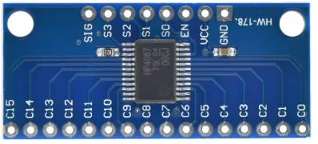
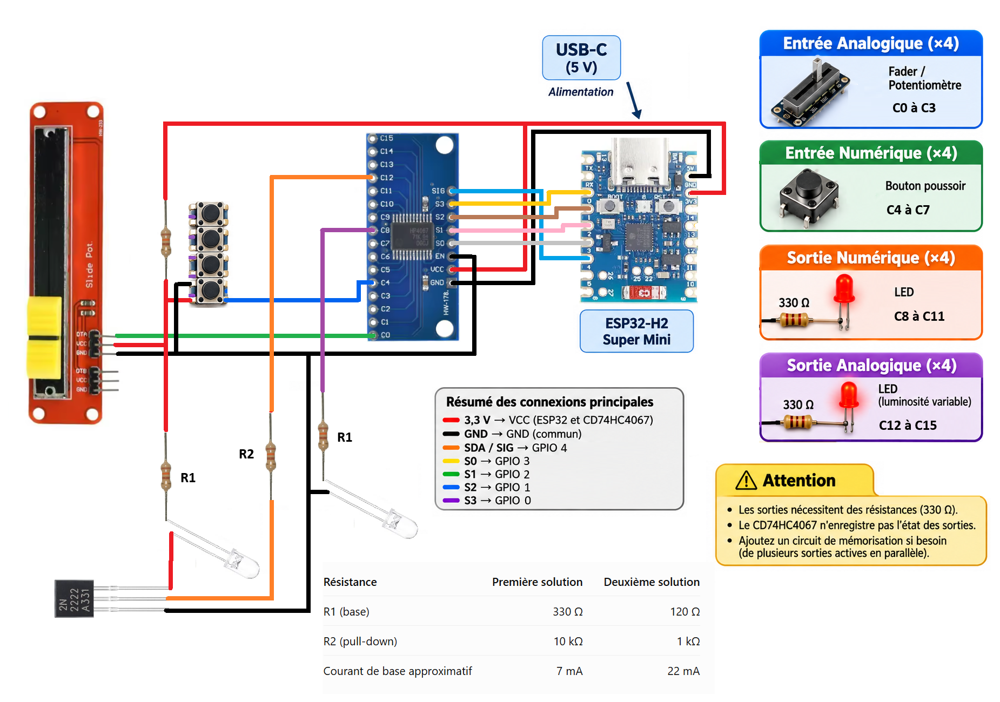

# ESP32-H2 : gérer des entrées et des sorties avec un CD74HC4067

## 1. Présentation du projet

### Objectif

Dans ce tutoriel, nous allons apprendre à utiliser un multiplexeur **CD74HC4067** avec un ESP32-H2 afin de gérer  plusieurs signaux avec un nombre réduit de broches.

Le CD74HC4067 dispose de 16 voies indépendantes, notées C0 à C15, et d'une broche commune appelée `SIG`. Quatre broches de sélection (`S0`, `S1`, `S2` et `S3`) permettent de connecter une seule de ces voies à la broche commune à un instant donné.

Le composant est bidirectionnel : le signal peut circuler d'une voie vers `SIG` ou de `SIG` vers une voie. Il peut donc être utilisé pour lire des entrées, mais aussi pour distribuer un signal de commande vers une sortie.

Dans ce tutoriel, nous allons exploiter ces possibilités pour réaliser un montage mixte comprenant :

- **4 entrées analogiques** : quatre faders ou potentiomètres.
- **4 entrées numériques** : quatre boutons poussoirs.
- **4 sorties numériques** : quatre LED commandées en tout ou rien.
- **4 sorties à luminosité variable** : quatre LED commandées par PWM.

Nous utiliserons ainsi les 16 voies du CD74HC4067 avec seulement quatre GPIO de sélection et une broche commune `SIG` sur l'ESP32-H2.

> **Important :** le CD74HC4067 ne possède qu'une seule voie commune. Une seule des 16 voies est reliée à `SIG` à la fois. Le programme devra donc sélectionner les voies successivement. Les entrées ne sont pas toutes échantillonnées exactement au même instant et les sorties ne sont pas pilotées simultanément par des signaux indépendants.

### Ce que nous allons réaliser

À la fin de ce tutoriel, nous saurons :

- Connecter un CD74HC4067 à un ESP32-H2.
- Sélectionner ses 16 voies avec quatre GPIO.
- Lire quatre faders ou potentiomètres.
- Lire quatre boutons poussoirs.
- Commander quatre LED en numérique.
- Régler la luminosité de quatre autres LED avec un signal PWM.
- Organiser le programme pour parcourir successivement les différentes voies.

### Répartition des 16 voies

| Voie | Type | Composant | Fonction |
|---|---|---|---|
| C0 | Entrée analogique | Fader 1 | Lecture de position |
| C1 | Entrée analogique | Fader 2 | Lecture de position |
| C2 | Entrée analogique | Fader 3 | Lecture de position |
| C3 | Entrée analogique | Fader 4 | Lecture de position |
| C4 | Entrée numérique | Bouton 1 | Détection appui/relâchement |
| C5 | Entrée numérique | Bouton 2 | Détection appui/relâchement |
| C6 | Entrée numérique | Bouton 3 | Détection appui/relâchement |
| C7 | Entrée numérique | Bouton 4 | Détection appui/relâchement |
| C8 | Sortie numérique | LED 1 | Allumage/extinction |
| C9 | Sortie numérique | LED 2 | Allumage/extinction |
| C10 | Sortie numérique | LED 3 | Allumage/extinction |
| C11 | Sortie numérique | LED 4 | Allumage/extinction |
| C12 | Sortie PWM | LED 5 | Réglage de luminosité |
| C13 | Sortie PWM | LED 6 | Réglage de luminosité |
| C14 | Sortie PWM | LED 7 | Réglage de luminosité |
| C15 | Sortie PWM | LED 8 | Réglage de luminosité |

Les quatre dernières voies sont souvent décrites comme des sorties analogiques dans un projet de ce type. Techniquement, l'ESP32-H2 produit ici un signal **PWM** (modulation de largeur d'impulsion), et non une véritable tension analogique continue. Pour une LED, la variation du rapport cyclique permet de régler la luminosité perçue.

## 2. Les prérequis et le matériel nécessaire

### Composants électroniques

| Composant | Quantité | Fonction |
|---|---:|---|
| ESP32-H2 (version SuperMini dans ce tutoriel) | 1 | Microcontrôleur principal |
| Module CD74HC4067 | 1 | Multiplexeur/démultiplexeur 16 voies |
| Faders ou potentiomètres linéaires | 4 | Entrées analogiques |
| Boutons poussoirs | 4 | Entrées numériques |
| LED classiques | 8 | Visualisation des sorties |
| Résistances de limitation de courant | 8 | Protection des LED |
| Résistances pull-up (par exemple 10 kΩ) | 4 | Stabilisation des entrées boutons |
| Condensateur céramique 100 nF | Optionnel | Découplage de l'alimentation |
| Breadboard | 1 | Montage expérimental |
| Fils de connexion | Selon besoin | Câblage |

*CD74HC4067: 



### Logiciels nécessaires

- Arduino IDE.
- Support de cartes ESP32 d'Espressif.
- Moniteur série réglé à 115200 bauds.

Aucune bibliothèque dédiée au CD74HC4067 n'est nécessaire : nous commandons directement ses quatre broches de sélection.

## 3. Présentation du CD74HC4067

### Qu'est-ce que le CD74HC4067 ?

Le CD74HC4067 est un multiplexeur/démultiplexeur analogique 16 voies. Il contient 16 interrupteurs électroniques qui relient une voie choisie à une broche commune.

Il ne convertit pas un signal et ne crée pas de tension. Il établit simplement une connexion entre `SIG` et l'une des broches C0 à C15.

### Les broches principales

| Broche | Rôle |
|---|---|
| SIG / COM | Broche commune reliée à l'ESP32 |
| C0 à C15 | Les 16 voies sélectionnables |
| S0 | Bit de sélection de poids faible |
| S1 | Bit de sélection |
| S2 | Bit de sélection |
| S3 | Bit de sélection de poids fort |
| EN / E | Activation du composant, généralement active à l'état bas (LOW) |
| VCC | Alimentation logique |
| GND | Masse |

La désignation exacte et l'emplacement des broches peuvent varier selon le fabricant et le module. Vérifier le marquage du module utilisé.

### Comment sélectionner une voie ?

Les quatre entrées S0 à S3 forment un nombre binaire compris entre 0 et 15.

| S3 | S2 | S1 | S0 | Voie sélectionnée |
|---:|---:|---:|---:|---|
| 0 | 0 | 0 | 0 | C0 |
| 0 | 0 | 0 | 1 | C1 |
| 0 | 0 | 1 | 0 | C2 |
| 0 | 0 | 1 | 1 | C3 |
| 0 | 1 | 0 | 0 | C4 |
| 0 | 1 | 0 | 1 | C5 |
| 0 | 1 | 1 | 0 | C6 |
| 0 | 1 | 1 | 1 | C7 |
| 1 | 0 | 0 | 0 | C8 |
| 1 | 0 | 0 | 1 | C9 |
| 1 | 0 | 1 | 0 | C10 |
| 1 | 0 | 1 | 1 | C11 |
| 1 | 1 | 0 | 0 | C12 |
| 1 | 1 | 0 | 1 | C13 |
| 1 | 1 | 1 | 0 | C14 |
| 1 | 1 | 1 | 1 | C15 |

Par exemple, pour sélectionner C5, il faut appliquer S3=LOW, S2=HIGH, S1=LOW et S0=HIGH.

### Un composant bidirectionnel

Le CD74HC4067 peut fonctionner dans les deux sens :

- **Multiplexage :** un signal provenant de l'une des voies C0 à C15 est transmis vers `SIG`. C'est le cas lorsque nous lisons un fader ou un bouton.
- **Démultiplexage :** un signal appliqué sur `SIG` est transmis vers la voie sélectionnée. C'est le cas lorsque nous commandons une LED.

Le sens du signal dépend de la configuration de la broche commune `SIG` et du circuit raccordé à la voie sélectionnée.

### Caractéristiques et limites à connaître

| Caractéristique | Description |
|---|---|
| Nombre de voies | 16 |
| Broche commune | 1 |
| Broches de sélection | 4 |
| Type | Multiplexeur/démultiplexeur analogique |
| Sens de circulation | Bidirectionnel |
| Activation | Broche EN/E |
| Signaux utilisables | Analogiques et numériques, dans les limites électriques du composant |

Pour notre montage, nous utiliserons une logique en **3,3 V**, compatible avec l'ESP32-H2. Les tensions appliquées aux voies doivent rester dans les limites électriques du composant et ne jamais dépasser les limites des GPIO de l'ESP32-H2.

### Les avantages du CD74HC4067

- Permet de sélectionner 16 voies avec seulement quatre GPIO de sélection.
- Peut transporter des signaux analogiques ou numériques.
- Fonctionne dans les deux sens.
- Permet de mélanger des entrées et des sorties dans un même montage.
- Peu coûteux et facile à trouver sous forme de module.

### Les inconvénients et les limites

**1. Une seule voie est connectée à la fois**

Le CD74HC4067 ne permet pas de lire les 16 entrées simultanément. L'ESP32 doit sélectionner les voies successivement.

**2. Une seule broche commune**

Toutes les voies partagent `SIG`. Il faut donc organiser le programme pour passer du mode entrée au mode sortie lorsque l'on change de famille de voies.

**3. Une résistance à l'état passant**

Le circuit n'est pas un fil parfait. Sa résistance interne peut introduire des erreurs, notamment avec des sources de forte impédance ou des mesures analogiques exigeantes.

**4. Pas de conversion analogique/numérique**

Le CD74HC4067 ne remplace pas un convertisseur ADC. Pour lire un potentiomètre, il faut toujours utiliser une entrée ADC de l'ESP32.

**5. Pas de conversion numérique/analogique**

Le composant ne génère pas une tension analogique. Pour faire varier la luminosité d'une LED, nous utiliserons un signal PWM généré par l'ESP32 et transmis par le multiplexeur.

**6. Les sorties ne sont pas mémorisées**

Comme une seule voie est connectée à `SIG`, une sortie n'est plus activement pilotée par l'ESP32 lorsque le programme sélectionne une autre voie. Le CD74HC4067 n'est pas un expandeur de sorties avec mémorisation.

Pour maintenir plusieurs sorties dans un état stable entre deux sélections, il faut ajouter un circuit de mémorisation ou un étage de commande adapté (par exemple un latch, un registre à décalage ou un driver PWM). Le balayage rapide des voies peut être étudié pour certaines applications, mais il faut vérifier le scintillement et la stabilité : il ne faut pas supposer que les sorties conservent leur état.

## 4. Branchement du CD74HC4067 sur un ESP32-H2

### Principe de fonctionnement

Nous relions les quatre broches de sélection du CD74HC4067 à quatre GPIO de l'ESP32-H2.

La broche commune `SIG` est reliée à une broche de l'ESP32-H2 capable de fonctionner :

- En entrée ADC pour lire les faders.
- En entrée numérique pour lire les boutons.
- En sortie numérique pour commander les LED tout ou rien.
- En sortie PWM pour régler la luminosité des LED.

La broche `EN` (ou `E`) est maintenue à l'état LOW pour activer le multiplexeur, si le module utilisé possède une entrée d'activation active à LOW.

### Exemple de brochage ESP32-H2

Le tableau suivant donne un exemple de répartition. Les numéros de GPIO sont à confirmer avec le brochage exact de la carte ESP32-H2 SuperMini utilisée. Il faut choisir une broche `SIG` compatible ADC et quatre GPIO disponibles pour les sélections.

| ESP32-H2 | CD74HC4067 | Fonction |
|---|---|---|
| 3V3 | VCC | Alimentation logique |
| GND | GND | Masse commune |
| GPIO3 | S0 | Sélection bit 0 |
| GPIO2 | S1 | Sélection bit 1 |
| GPIO1 | S2 | Sélection bit 2 |
| GPIO0 | S3 | Sélection bit 3 |
| GPIO4 (exemple, à vérifier ADC) | SIG | Signal commun |
| GND | EN / E | Activation permanente |

**Important :** ne reprends pas automatiquement ces numéros de GPIO sans vérifier la carte. La broche raccordée à `SIG` doit notamment être une broche ADC utilisable sur ta variante d'ESP32-H2. Si elle ne l'est pas, choisis une autre broche et adapte la constante dans le programme.

### Connexion des quatre entrées analogiques

Chaque fader ou potentiomètre est câblé comme un diviseur de tension :

- Une extrémité sur 3,3 V.
- L'autre extrémité sur GND.
- Le curseur (broche centrale) sur une voie du CD74HC4067.

| Fader | Voie CD74HC4067 |
|---|---|
| Fader 1 | C0 |
| Fader 2 | C1 |
| Fader 3 | C2 |
| Fader 4 | C3 |

Le curseur fournit une tension comprise approximativement entre 0 et 3,3 V selon la position du fader.

### Connexion des quatre entrées numériques

Les boutons sont raccordés entre une voie et GND.

| Bouton | Voie CD74HC4067 |
|---|---|
| Bouton 1 | C4 |
| Bouton 2 | C5 |
| Bouton 3 | C6 |
| Bouton 4 | C7 |

Pour obtenir un niveau logique stable, chaque entrée doit disposer d'une résistance de rappel vers 3,3 V (pull-up). La résistance pull-up interne de l'ESP32 ne se trouve pas sur chacune des voies du multiplexeur : elle ne doit pas être supposée automatiquement disponible pour chaque bouton.

On peut donc utiliser une résistance externe par bouton, par exemple 10 kΩ entre la voie et 3,3 V, avec le bouton entre la voie et GND.

- Bouton relâché : niveau HIGH.
- Bouton appuyé : niveau LOW.

### Connexion des quatre sorties numériques

| LED | Voie CD74HC4067 |
|---|---|
| LED numérique 1 | C8 |
| LED numérique 2 | C9 |
| LED numérique 3 | C10 |
| LED numérique 4 | C11 |

Chaque LED doit être montée en série avec une résistance de limitation de courant.

Dans ce montage, le programme sélectionne une voie de sortie, place `SIG` en sortie et applique HIGH ou LOW. Il passe ensuite à la voie suivante.

**Attention :** une sortie non sélectionnée n'est plus activement pilotée par l'ESP32. Pour obtenir quatre états stables et indépendants, un circuit de mémorisation ou un driver de sorties est préférable. Le CD74HC4067 seul ne conserve pas quatre niveaux de sortie indépendants.

### Connexion des quatre sorties à luminosité variable

| LED | Voie CD74HC4067 |
|---|---|
| LED PWM 1 | C12 |
| LED PWM 2 | C13 |
| LED PWM 3 | C14 |
| LED PWM 4 | C15 |

Chaque LED est montée en série avec une résistance de limitation de courant.

Pour chaque voie, le programme sélectionne la sortie, configure `SIG` en PWM et applique le rapport cyclique correspondant à la luminosité souhaitée.

**Limite importante :** le PWM n'est transmis que sur la voie sélectionnée. Les quatre LED ne reçoivent donc pas quatre signaux PWM indépendants et continus en même temps. Pour un résultat robuste, un driver PWM externe ou un circuit de mémorisation adapté est recommandé.

### Découplage de l'alimentation

Placer un condensateur céramique de 100 nF entre VCC et GND, au plus près du module si possible.

### Schéma de câblage

Le schéma général devra montrer :

1. L'ESP32-H2.
2. Le module CD74HC4067.
3. Les connexions VCC, GND et EN.
4. Les quatre lignes S0, S1, S2 et S3.
5. La liaison entre `SIG` et la broche ADC/GPIO de l'ESP32-H2.
6. Quatre faders connectés à C0–C3.
7. Quatre boutons avec leurs résistances pull-up sur C4–C7.
8. Quatre LED numériques sur C8–C11.
9. Quatre LED commandées par PWM sur C12–C15.
10. Les résistances de limitation de courant des LED.

Toutes les masses doivent être communes.



## 5. Adapter le montage à d'autres ESP32

Le principe du CD74HC4067 peut être utilisé avec d'autres microcontrôleurs, notamment :

- ESP32 classique.
- ESP32-S2.
- ESP32-S3.
- ESP32-C3.
- ESP32-C6.
- ESP32-H2.
- Cartes Arduino compatibles avec les niveaux électriques du module.

Il faudra adapter :

- La broche ADC raccordée à `SIG`.
- Les quatre GPIO de sélection.
- La génération du PWM selon le microcontrôleur et la version de son environnement Arduino.
- Les limites de tension et de courant.

Vérifier systématiquement que la broche utilisée pour `SIG` possède bien une fonction ADC si l'on souhaite lire les faders.

## 6. Le programme : lire les entrées et commander les sorties

### Principe du programme

Le programme devra :

1. Initialiser les quatre GPIO de sélection.
2. Activer le CD74HC4067.
3. Sélectionner successivement C0 à C3 et lire les quatre faders avec l'ADC.
4. Sélectionner C4 à C7 et lire les quatre boutons.
5. Sélectionner C8 à C11 et commander les LED numériques.
6. Sélectionner C12 à C15 et appliquer les rapports cycliques PWM aux LED à luminosité variable.
7. Afficher les valeurs des entrées dans le moniteur série.

### Remarque importante sur les sorties multiplexées

Le code ci-dessous montre comment sélectionner les voies et transmettre un niveau ou un signal PWM à la voie choisie. Il ne transforme pas le CD74HC4067 en huit sorties indépendantes mémorisées.

Pour les sorties, il faut distinguer deux besoins :

- **Commande ponctuelle :** sélectionner une voie et transmettre un niveau ou un signal PWM.
- **Commande stable de plusieurs sorties :** utiliser un circuit externe qui mémorise les états, par exemple un latch, un registre à décalage ou un driver PWM.

Le programme de démonstration ci-dessous privilégie la lecture des entrées et illustre la commande des sorties sélectionnées. Pour une réalisation finale exigeant huit sorties maintenues indépendamment, ajouter le circuit de mémorisation décrit dans les améliorations possibles.

### Code de démonstration

> **À adapter avant téléversement :** vérifier les GPIO réellement disponibles sur la carte et choisir une broche `SIG` compatible ADC. La fonction `analogWrite()` dépend de la version du cœur Arduino-ESP32 installée. Si elle n'est pas disponible, utiliser l'API LEDC correspondant à cette version.

```cpp
#include <Arduino.h>

// =====================================================
// CONFIGURATION MATERIELLE
// =====================================================

// Broches de sélection du CD74HC4067
#define MUX_S0 3
#define MUX_S1 2
#define MUX_S2 1
#define MUX_S3 0

// Broche commune du multiplexeur
// Choisir une broche ADC disponible sur la carte ESP32-H2.
#define MUX_SIG 4

// Voies du CD74HC4067
const uint8_t analogInputChannels[4]   = {0, 1, 2, 3};
const uint8_t digitalInputChannels[4]  = {4, 5, 6, 7};
const uint8_t digitalOutputChannels[4] = {8, 9, 10, 11};
const uint8_t pwmOutputChannels[4]     = {12, 13, 14, 15};

// Valeurs lues
int faderValues[4] = {0, 0, 0, 0};
bool buttonStates[4] = {false, false, false, false};

// Etats souhaites des sorties
bool digitalLedStates[4] = {false, true, false, true};
uint8_t pwmLedValues[4] = {0, 80, 160, 255};

// Temporisation d'affichage
unsigned long previousPrintMillis = 0;
const unsigned long PRINT_INTERVAL = 250;

// =====================================================
// SELECTION D'UNE VOIE DU MULTIPLEXEUR
// =====================================================

void selectMuxChannel(uint8_t channel) {
  channel &= 0x0F;

  digitalWrite(MUX_S0, (channel & 0x01) ? HIGH : LOW);
  digitalWrite(MUX_S1, (channel & 0x02) ? HIGH : LOW);
  digitalWrite(MUX_S2, (channel & 0x04) ? HIGH : LOW);
  digitalWrite(MUX_S3, (channel & 0x08) ? HIGH : LOW);

  // Laisser le temps au signal de se stabiliser.
  delayMicroseconds(50);
}

// =====================================================
// LECTURE DES ENTREES ANALOGIQUES
// =====================================================

void readAnalogInputs() {
  pinMode(MUX_SIG, INPUT);

  for (uint8_t i = 0; i < 4; i++) {
    selectMuxChannel(analogInputChannels[i]);

    // Première lecture écartée pour laisser l'ADC se stabiliser.
    analogRead(MUX_SIG);
    delayMicroseconds(50);

    faderValues[i] = analogRead(MUX_SIG);
  }
}

// =====================================================
// LECTURE DES ENTREES NUMERIQUES
// =====================================================

void readDigitalInputs() {
  pinMode(MUX_SIG, INPUT);

  for (uint8_t i = 0; i < 4; i++) {
    selectMuxChannel(digitalInputChannels[i]);

    buttonStates[i] = (digitalRead(MUX_SIG) == LOW);
  }
}

// =====================================================
// COMMANDE DES SORTIES NUMERIQUES
// =====================================================

void updateDigitalOutputs() {
  for (uint8_t i = 0; i < 4; i++) {
    selectMuxChannel(digitalOutputChannels[i]);

    pinMode(MUX_SIG, OUTPUT);
    digitalWrite(MUX_SIG, digitalLedStates[i] ? HIGH : LOW);
  }

  pinMode(MUX_SIG, INPUT);
}

// =====================================================
// COMMANDE DES SORTIES PWM
// =====================================================

void updatePwmOutputs() {
  for (uint8_t i = 0; i < 4; i++) {
    selectMuxChannel(pwmOutputChannels[i]);

    pinMode(MUX_SIG, OUTPUT);

    // analogWrite génère un signal PWM sur SIG.
    // Le CD74HC4067 le transmet à la voie sélectionnée.
    analogWrite(MUX_SIG, pwmLedValues[i]);
  }

  // Le multiplexeur ne mémorise pas un PWM indépendant par voie.
  pinMode(MUX_SIG, INPUT);
}

// =====================================================
// AFFICHAGE MONITEUR SERIE
// =====================================================

void printValues() {
  Serial.println();
  Serial.println("----- ENTREES ANALOGIQUES -----");

  for (uint8_t i = 0; i < 4; i++) {
    Serial.print("Fader ");
    Serial.print(i + 1);
    Serial.print(" : ");
    Serial.println(faderValues[i]);
  }

  Serial.println("----- ENTREES NUMERIQUES -----");

  for (uint8_t i = 0; i < 4; i++) {
    Serial.print("Bouton ");
    Serial.print(i + 1);
    Serial.print(" : ");
    Serial.println(buttonStates[i] ? "APPUYE" : "RELACHE");
  }
}

// =====================================================
// INITIALISATION
// =====================================================

void setup() {
  Serial.begin(115200);
  delay(500);

  Serial.println();
  Serial.println("Demarrage CD74HC4067 avec ESP32-H2");

  pinMode(MUX_S0, OUTPUT);
  pinMode(MUX_S1, OUTPUT);
  pinMode(MUX_S2, OUTPUT);
  pinMode(MUX_S3, OUTPUT);

  pinMode(MUX_SIG, INPUT);

  analogReadResolution(12);

  selectMuxChannel(0);

  Serial.println("CD74HC4067 initialise.");
}

// =====================================================
// BOUCLE PRINCIPALE
// =====================================================

void loop() {
  readAnalogInputs();
  readDigitalInputs();

  updateDigitalOutputs();
  updatePwmOutputs();

  unsigned long currentMillis = millis();

  if (currentMillis - previousPrintMillis >= PRINT_INTERVAL) {
    previousPrintMillis = currentMillis;
    printValues();
  }
}
```

### Explication des principales parties du code

**1. Sélection d'une voie**

```cpp
void selectMuxChannel(uint8_t channel) {
  digitalWrite(MUX_S0, (channel & 0x01) ? HIGH : LOW);
  digitalWrite(MUX_S1, (channel & 0x02) ? HIGH : LOW);
  digitalWrite(MUX_S2, (channel & 0x04) ? HIGH : LOW);
  digitalWrite(MUX_S3, (channel & 0x08) ? HIGH : LOW);
}
```

Les quatre GPIO forment un nombre binaire. Cette fonction permet de sélectionner automatiquement la voie souhaitée, de 0 à 15.

**2. Lecture des faders**

```cpp
faderValues[i] = analogRead(MUX_SIG);
```

Après avoir sélectionné une voie, l'ESP32 mesure la tension présente sur `SIG` grâce à son convertisseur analogique/numérique.

La résolution configurée dans l'exemple est de 12 bits. La valeur retournée est généralement comprise entre 0 et 4095, selon la configuration ADC et le cœur Arduino utilisé.

**3. Lecture des boutons**

```cpp
buttonStates[i] = (digitalRead(MUX_SIG) == LOW);
```

Les boutons sont câblés avec une résistance pull-up externe. L'entrée est donc HIGH au repos et LOW lorsque le bouton est appuyé.

**4. Commande des LED numériques**

```cpp
pinMode(MUX_SIG, OUTPUT);
digitalWrite(MUX_SIG, digitalLedStates[i] ? HIGH : LOW);
```

Le programme sélectionne une voie, configure `SIG` en sortie et applique le niveau logique demandé.

Attention : le CD74HC4067 ne mémorise pas l'état de chaque sortie. Pour conserver quatre états indépendants de manière fiable, il faut ajouter un circuit de mémorisation.

**5. Commande des LED avec PWM**

```cpp
analogWrite(MUX_SIG, pwmLedValues[i]);
```

La fonction PWM applique un rapport cyclique à la broche commune. Le multiplexeur transmet le signal à la voie sélectionnée.

Une valeur de 0 correspond à un rapport cyclique nul et une valeur maximale à un rapport cyclique maximal, selon la résolution PWM utilisée.

Le PWM n'est toutefois transmis qu'à la voie actuellement sélectionnée. Pour quatre luminosités indépendantes et stables, un driver PWM externe est recommandé.

## 7. Tests et validation du montage

### Étape 1 : vérifier le multiplexeur

Après avoir téléversé le programme, ouvrir le moniteur série à 115200 bauds.

Vérifier que le programme démarre et que les valeurs des entrées sont affichées.

### Étape 2 : tester les quatre faders

Déplacer chaque fader successivement.

Les valeurs doivent évoluer dans le moniteur série :

- Position minimale : valeur proche du minimum ADC.
- Position intermédiaire : valeur intermédiaire.
- Position maximale : valeur proche du maximum ADC.

Les valeurs exactes dépendent de l'ADC, de l'alimentation et du potentiomètre utilisé.

### Étape 3 : tester les quatre boutons

Appuyer puis relâcher chaque bouton.

Le moniteur série doit afficher son état :

```text
Bouton 1 : APPUYE
Bouton 1 : RELACHE
```

Si une entrée reste instable, vérifier la résistance pull-up, la masse commune et les connexions.

### Étape 4 : tester les sorties numériques

Vérifier que chaque LED numérique réagit lorsque sa voie est sélectionnée et que le niveau demandé est appliqué.

Pour un test plus simple, ne connecter qu'une seule LED à la fois et vérifier successivement les voies C8 à C11.

Pour un fonctionnement avec quatre états indépendants maintenus, ajouter un circuit de mémorisation externe : le CD74HC4067 seul n'est pas un expandeur de sorties mémorisées.

### Étape 5 : tester les sorties PWM

Tester différentes valeurs de rapport cyclique :

| Valeur PWM | Luminosité demandée |
|---:|---|
| 0 | Éteinte |
| 64 | Faible |
| 128 | Moyenne |
| 192 | Forte |
| 255 | Maximale |

Observer les LED et vérifier l'absence de scintillement gênant.

Le multiplexage PWM peut provoquer une luminosité instable ou du scintillement. Si le résultat n'est pas satisfaisant, utiliser un driver PWM externe ou des sorties PWM indépendantes.

### Étape 6 : vérifier les interactions

Déplacer les faders tout en appuyant sur les boutons.

Le programme doit continuer à parcourir les voies et à mettre à jour les valeurs. Les lectures ne sont cependant pas simultanées : chaque voie est mesurée à son tour.

## 8. Les améliorations possibles pour la suite

### Ajouter davantage de voies analogiques

Le CD74HC4067 peut être utilisé pour lire jusqu'à 16 potentiomètres ou capteurs analogiques, à condition de respecter les limites électriques et les caractéristiques de l'ADC.

### Ajouter davantage de boutons

Les voies peuvent aussi servir à lire des boutons, interrupteurs ou contacts numériques.

Il faudra prévoir des résistances de rappel et gérer les rebonds logiciels des boutons.

### Ajouter un circuit de mémorisation pour les sorties

Pour disposer de plusieurs sorties numériques indépendantes qui conservent leur état, on peut ajouter un registre à décalage ou un latch.

Le CD74HC4067 peut alors servir à sélectionner les signaux nécessaires, tandis que le circuit externe conserve les états des sorties.

### Utiliser un driver PWM externe

Pour commander plusieurs LED avec des luminosités indépendantes et stables, un driver PWM tel qu'un PCA9685 est une solution plus adaptée.

Il permet de générer plusieurs sorties PWM sans devoir faire passer chaque signal par la broche commune du multiplexeur.

### Créer un contrôleur MIDI

Ce montage peut servir de base à un contrôleur MIDI :

- Les faders fournissent les valeurs analogiques.
- Les boutons déclenchent des commandes.
- Les LED indiquent un état ou une sélection.

Il faudra compléter le programme avec la gestion MIDI et, selon le besoin, un circuit de commande des LED adapté.

### Intégrer le montage à Home Assistant

L'ESP32-H2 peut également être utilisé dans un projet domotique. Les valeurs des faders et les états des boutons pourront servir à piloter des entités ou des automatisations, selon l'architecture de communication choisie.

## 9. Conclusion

Le CD74HC4067 permet d'exploiter 16 voies avec seulement quatre broches de sélection et une broche commune sur l'ESP32-H2.

Dans ce tutoriel, nous avons réparti ces voies entre quatre entrées analogiques, quatre entrées numériques, quatre sorties numériques et quatre sorties à luminosité variable.

Ce montage montre la polyvalence du multiplexeur : il peut transmettre des signaux analogiques ou numériques dans les deux sens.

Il faut toutefois garder à l'esprit qu'une seule voie est connectée à la fois et que le CD74HC4067 ne mémorise pas les états des sorties. Pour des sorties indépendantes et stables, il faudra lui associer un circuit de mémorisation ou un driver dédié.

Cette base pourra être réutilisée pour créer des contrôleurs, des interfaces de commande, des projets MIDI ou des dispositifs domotiques autour de l'ESP32-H2.
