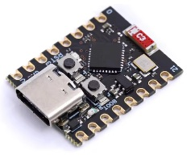
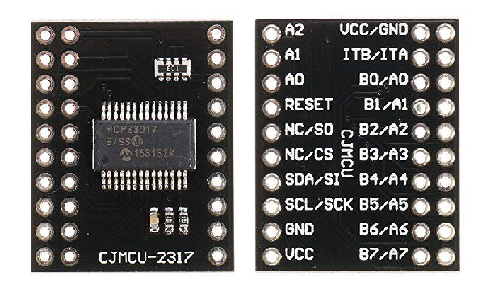
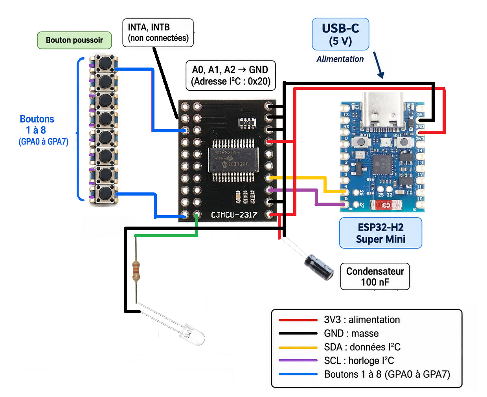

# ESP32 : ajouter 16 entrées/sorties avec un MCP23017

## 1. Présentation du projet

### Objectif

Dans ce tutoriel, nous allons apprendre à ajouter 16 entrées/sorties numériques supplémentaires à un ESP32 grâce au circuit MCP23017.

Les microcontrôleurs ESP32 disposent d'un nombre limité de broches GPIO.

Lorsque l'on commence à multiplier les boutons, les interrupteurs, les LED ou les autres périphériques, on peut rapidement manquer de broches disponibles.

Le MCP23017 permet de résoudre ce problème en ajoutant 16 GPIO supplémentaires, accessibles depuis l'ESP32 au moyen d'une simple liaison I²C.

Nous allons utiliser un ESP32-H2, un microcontrôleur particulièrement intéressant pour ce projet puisqu'il dispose d'un  ombre limité de broches disponibles selon la carte utilisée.

### Ce que nous allons réaliser

À la fin de ce tutoriel, nous saurons :

-   Connecter un MCP23017 à un ESP32-H2.
-   Communiquer avec le MCP23017 grâce au bus I²C.
-   Configurer ses broches en entrées ou en sorties.
-   Lire l'état de plusieurs boutons.
-   Commander des sorties numériques.

Pour illustrer son fonctionnement, nous réaliserons un montage permettant de lire **15 boutons indépendants** et de  commander une **LED avec la broche GPB7**.

**L'intérêt :** nous n'utiliserons que deux GPIO de l'ESP32 pour communiquer avec les 16 entrées/sorties supplémentaires.

Ce montage pourra ensuite être réutilisé dans différents projets,
notamment :

-   Un clavier ou un panneau de commande.
-   Un contrôleur MIDI.
-   Un interrupteur Zigbee avec plusieurs boutons.
-   Un système de commande domotique.
-   Une carte de commande avec des LED ou des relais adaptés.

# 📺 Vidéo

Lien Youtube: [https://www.youtube.com/@Baronnix](https://www.youtube.com/@Baronnix)

## 2. Les prérequis et le matériel nécessaire

### Composants électroniques

| Composant  | Quantité | Fonction |
| --------------------- | -------------- | ------------------------------ |
| ESP32-H2 (Version SuperMini dans ce tutoriel) | 1 | Microcontrôleur principal |
| MCP23017 (Carte CJMCU-2317 dans ce tutoriel) | 1 | Extension de 16 GPIO |
| Boutons poussoirs | 2 minimum | Simulation des entrées |
| Condensateur 100 nF | 1 | Découplage de l'alimentation |
| Breadboard | 1 | Montage expérimental |
| Fils | Selon besoin | Connexions |
| Diode | Selon besoin | Affichage état des sorties |
| Résistance 130 Ohms | Selon besoin | Limitation courant diode |


La broche RESET du MCP23017 doit être maintenue à l'état HIGH. Selon le module utilisé, une résistance de rappel est déjà présente. Sinon, prévoir une résistance de rappel vers 3,3 V.

Le condensateur de 100 nF est recommandé pour stabiliser l'alimentation du circuit. Il doit être placé au plus près des  broches d'alimentation du MCP23017.

* ESP32-H2 Super Mini



* CJMCU-2317




### Logiciels nécessaires

-   Arduino IDE.
-   Le support de cartes ESP32 d'Espressif.
-   La bibliothèque `Adafruit MCP23X17 Arduino Library`.
-   La bibliothèque `Adafruit BusIO`, installée automatiquement si nécessaire.

### Installation de la bibliothèque

Dans Arduino IDE :

1.  Ouvrir le gestionnaire de bibliothèques.
2.  Rechercher `Adafruit MCP23X17`.
3.  Installer la bibliothèque Adafruit MCP23X17.
4.  Vérifier que ses dépendances sont installées.

Nous utiliserons cette bibliothèque pour simplifier la configuration et la lecture des broches du MCP23017.

## 3. Présentation du MCP23017

### Qu'est-ce que le MCP23017 ?

Le MCP23017 est un circuit intégré fabriqué par Microchip. Il s'agit d'un expandeur de ports d'entrées/sorties numériques, également appelé GPIO Expander.

Son rôle est d'augmenter le nombre de broches disponibles sur un microcontrôleur.

Il communique avec celui-ci grâce au protocole I²C, qui utilise seulement deux lignes :

-   **SDA** : transmission des données.
-   **SCL** : signal d'horloge.

En utilisant ces deux lignes, l'ESP32 peut configurer et commander les 16 GPIO du MCP23017.

### Les 16 entrées/sorties

Le MCP23017 dispose de deux groupes de huit broches :

-   **PORT A** : GPA0 à GPA7.
-   **PORT B** : GPB0 à GPB7.

Cela donne un total de 16 GPIO indépendants.

Chaque broche peut être configurée individuellement en :

-   Entrée numérique.
-   Entrée numérique avec résistance pull-up interne.
-   Sortie numérique.

Il est donc possible de mélanger les utilisations.

Par exemple :

-   8 boutons sur le port A.
-   4 LED sur le port B.
-   4 autres entrées sur le port B.

### Les principales caractéristiques

| Caractéristique| Valeur |
| ------------------------------ | ------------------- |
| Nombre de GPIO | 16 |
| Organisation | 2 ports de 8 bits |
| Communication | I²C |
| Adresse I²C de base | 0x20
| Adresses possibles | 0x20 à 0x27 |
| Tension de fonctionnement | 1,8 à 5,5 V |
| Résistances pull-up internes | Oui |
| Gestion des interruptions | Oui
| Configuration individuelle | Oui |
| Sorties numériques | HIGH / LOW |

Le composant accepte plusieurs fréquences de communication I²C, notamment 100 kHz et 400 kHz.

### L'adressage I²C

Le MCP23017 possède trois broches d'adressage :

-   A0
-   A1
-   A2

Ces trois broches permettent de définir son adresse I²C.

En reliant les trois broches à la masse, on obtient l'adresse 0x20.

Il est possible de connecter jusqu'à huit MCP23017 sur le même bus I²C, à condition de leur attribuer des adresses différentes.

Cela permet théoriquement d'obtenir : **8 × 16 = 128 GPIO supplémentaires.**

Les broches SDA et SCL restent communes à tous les composants.

### Les résistances pull-up internes

Le MCP23017 intègre des résistances pull-up configurables sur ses entrées.

Cela évite généralement d'ajouter une résistance externe pour chaque bouton poussoir.

Dans notre exemple, nous utiliserons ces résistances internes.

Le principe sera simple :

-   Une borne du bouton est connectée à une entrée du MCP23017.
-   L'autre borne est connectée à GND.
-   Lorsque le bouton est relâché, l'entrée est à HIGH.
-   Lorsque le bouton est appuyé, l'entrée passe à LOW.

### Les interruptions

Le MCP23017 dispose également de deux sorties d'interruption :

-   INTA.
-   INTB.

Elles permettent d'avertir l'ESP32 lorsqu'une entrée change d'état.

Au lieu de lire régulièrement toutes les entrées, l'ESP32 peut attendre une interruption pour savoir qu'un changement s'est produit.

C'est particulièrement intéressant lorsque l'on utilise de nombreux boutons ou que l'on souhaite réduire l'activité du microcontrôleur.

Nous n'utiliserons pas cette fonctionnalité dans notre premier exemple, mais elle pourra faire l'objet d'une amélioration ultérieure.

### Les avantages du MCP23017

-   Ajoute 16 GPIO avec seulement deux broches de communication.
-   Permet de connecter plusieurs circuits sur le même bus I²C.
-   Chaque entrée/sortie est configurable indépendamment.
-   Dispose de résistances pull-up internes.
-   Gère les interruptions matérielles.
-   Fonctionne avec une alimentation compatible avec la logique 3,3 V de     l'ESP32.
-   Facile à utiliser avec Arduino et ESP32.

### Les inconvénients et les limites

Le MCP23017 présente également quelques limites à connaître.

**1. Une communication plus lente qu'un GPIO direct**

Chaque lecture ou écriture nécessite une communication I²C. Il y a donc davantage de latence qu'avec une broche directement connectée à l'ESP32.

Pour des boutons, des interrupteurs ou des LED, ce n'est généralement pas un problème.

En revanche, ce n'est pas adapté aux signaux nécessitant une réaction extrêmement rapide ou une fréquence élevée.

**2. Une communication partagée**

Les différents composants présents sur le bus I²C partagent les mêmes lignes SDA et SCL.

Une mauvaise configuration ou un périphérique qui bloque le bus peut perturber les communications.

**3. Des sorties qui ne sont pas destinées aux fortes puissances**

Le MCP23017 commande des signaux logiques. Il ne doit pas alimenter directement des moteurs, des relais gourmands ou des charges importantes.

Pour commander ces éléments, il faut ajouter un étage de puissance adapté : transistor, MOSFET ou circuit driver.

**4. Une extension uniquement numérique**

Le MCP23017 ne dispose pas d'entrées analogiques.

Il ne permet donc pas de lire directement la position d'un potentiomètre.

Pour cela, nous utiliserons un autre composant dans un prochain tutoriel : le CD74HC4067.

### MCP23017 ou CD74HC4067 : quelle différence ?

Ces deux composants permettent d'augmenter le nombre de signaux accessibles depuis un microcontrôleur, mais leur fonctionnement est différent.

-   **MCP23017** : ajoute 16 entrées/sorties numériques indépendantes.
-   **CD74HC4067** : permet de sélectionner une entrée parmi 16 voies à     l'aide de quatre lignes de sélection.

Le MCP23017 est donc particulièrement adapté aux boutons, interrupteurs et sorties numériques.

Le CD74HC4067 est notamment intéressant pour lire plusieurs potentiomètres avec un seul canal ADC.

## 4. Branchement du MCP23017 sur un ESP32-H2

### Principe de fonctionnement

Nous allons relier le MCP23017 à l'ESP32-H2 grâce au bus I²C.

Il suffit de connecter :

-   SDA de l'ESP32 vers SDA du MCP23017.
-   SCL de l'ESP32 vers SCL du MCP23017.
-   3,3 V vers VDD.
-   GND vers VSS.

Les 16 GPIO du MCP23017 seront ensuite disponibles pour connecter nos périphériques.

### Tableau de câblage

| ESP32-H2 | MCP23017 | Fonction |
| ---------- | ---------- | -------------- |
| 3V3 | VDD | Alimentation |
| GND | VSS | Masse |
| GPIO4 | SDA | Données I²C |
| GPIO5 | SCL | Horloge I²C |

GPIO4 et GPIO5 sont des exemples de broches à utiliser si elles sont disponibles sur ta carte. Il faudra vérifier le brochage exact de la version de ton ESP32-H2.

### Connexions complémentaires du MCP23017

| Broche MCP23017 | Connexion |
| ----------------- | ------------------------------------ |
| A0 | GND |
| A1 | GND |
| A2 | GND |
| RESET | 3,3 V |
| INTA | Non connectée pour ce premier test |
| INTB | Non connectée pour ce premier test |

Les trois broches d'adressage reliées à GND donnent l'adresse I²C 0x20.

La broche RESET doit être maintenue à l'état HIGH pour que le circuit fonctionne normalement. Une résistance de rappel vers 3,3 V peut être utilisée si elle n'est pas déjà présente sur le module.

### Connexion des boutons

Nous utilisons maintenant **15 GPIO en entrées** : les huit broches du port A et les sept premières broches du port B. 

La dernière broche, GPB7, est réservée à la LED.

Les boutons sont connectés entre leur broche MCP23017 et GND.

| Bouton | Broche MCP23017 |
|---:|---|
| 1 à 8 | GPA0 à GPA7 |
| 9 | GPB0 |
| 10 | GPB1 |
| 11 | GPB2 |
| 12 | GPB3 |
| 13 | GPB4 |
| 14 | GPB5 |
| 15 | GPB6 |

Chaque bouton utilise la résistance pull-up interne du MCP23017.

### Connexion de la LED sur GPB7

**GPB7 → résistance de 130 Ω → anode (+) de la LED ; cathode (−) de la LED → GND.**

La résistance est indispensable pour limiter le courant dans la LED. Avec ce câblage, GPB7 à HIGH allume la LED et GPB7 à LOW l'éteint. 

Vérifier le courant admissible par broche et par port dans la datasheet; ne pas utiliser le MCP23017 pour alimenter une LED de puissance.

### Schéma de câblage

Le schéma général doit montrer :

1.  L'ESP32-H2 à droite.
2.  Le MCP23017 à gauche.
3.  Les connexions 3,3 V et GND.
4.  Les deux lignes I²C SDA et SCL.
5.  Les broches A0, A1 et A2 reliées à GND.
6.  RESET relié au 3,3 V.
7.  Les 16 boutons connectés individuellement aux broches GPA0 à GPA7 et GPB0 à GPB7.
8.  Un condensateur de 100 nF entre VDD et GND, au plus près du MCP23017.

Attention : toutes les masses doivent être communes.



## 5. Adapter le montage à d'autres ESP32

Même si nous utilisons un ESP32-H2, le MCP23017 fonctionne également avec de nombreux autres microcontrôleurs.

On peut notamment l'utiliser avec :

-   ESP32 classique.
-   ESP32-S2.
-   ESP32-S3.
-   ESP32-C3.
-   ESP32-C6.
-   Arduino Uno.
-   Arduino Mega.

Le principe de branchement reste identique : une alimentation compatible, une masse commune et deux lignes I²C.

La principale différence concerne le choix des broches SDA et SCL.

Sur les ESP32, ces broches peuvent généralement être affectées à différents GPIO grâce à la matrice de routage.

Dans notre programme, il suffira donc de modifier les deux numéros de GPIO utilisés pour le bus I²C.

Il faudra également vérifier la tension logique, les broches disponibles et les éventuelles restrictions propres à chaque carte.

## 6. Le programme : lire 15 entrées et faire clignoter une LED

Le programme lit les 15 boutons connectés à GPA0–GPA7 et GPB0–GPB6.

La broche GPB7 est configurée en sortie et commande une LED. La LED change d'état toutes les **2 secondes**, sans bloquer la lecture des boutons grâce à `millis()`.

### Principe du programme

Le programme devra :

1. Initialiser la communication I²C.
2. Initialiser le MCP23017 à l'adresse 0x20.
3. Configurer GPA0 à GPA7 et GPB0 à GPB6 en entrées avec pull-up.
4. Configurer GPB7 en sortie pour commander la LED.
5. Lire régulièrement les 15 entrées et afficher les changements.
6. Inverser l'état de la LED toutes les 2 secondes.

Nous utilisons la numérotation de la bibliothèque Adafruit : les broches 0 à 7 correspondent à GPA0 à GPA7, et les broches 8 à 15 à GPB0 à GPB7. 

GPB7 correspond donc à l'index **15**.

### Code complet

```cpp
#include <Wire.h>
#include <Adafruit_MCP23X17.h>

// -----------------------------
// Configuration I2C
// -----------------------------

#define SDA_PIN 4
#define SCL_PIN 5

// Adresse I2C du MCP23017
#define MCP_ADDRESS 0x20

// -----------------------------
// Broches du MCP23017
// -----------------------------

#define LED_PIN 15  // GPB7 : sortie LED

const int INPUT_COUNT = 15;  // GPA0 à GPA7 et GPB0 à GPB6
const unsigned long LED_INTERVAL = 2000; // 2 secondes

Adafruit_MCP23X17 mcp;

// Mémorisation de l'état des 15 entrées
bool previousState[INPUT_COUNT];

// Gestion du clignotement sans delay()
bool ledState = false;
unsigned long previousLedMillis = 0;

// -----------------------------
// Initialisation
// -----------------------------

void setup() {
  Serial.begin(115200);
  delay(500);

  Serial.println();
  Serial.println("Demarrage MCP23017");

  // Initialisation I2C
  Wire.begin(SDA_PIN, SCL_PIN);

  // Initialisation du MCP23017
  if (!mcp.begin_I2C(MCP_ADDRESS, &Wire)) {
    Serial.println("Erreur : MCP23017 introuvable !");
    while (1) {
      delay(100);
    }
  }

  Serial.println("MCP23017 detecte !");

  // Configuration des 15 entrees : GPA0-GPA7 et GPB0-GPB6
  for (int i = 0; i < INPUT_COUNT; i++) {
    mcp.pinMode(i, INPUT_PULLUP);
    previousState[i] = mcp.digitalRead(i);
  }

  // GPB7 (index 15) est reserve a la LED
  mcp.pinMode(LED_PIN, OUTPUT);
  mcp.digitalWrite(LED_PIN, LOW);

  Serial.println("15 entrees configurees.");
  Serial.println("GPB7 configuree en sortie pour la LED.");
  Serial.println("La LED changera d'etat toutes les 2 secondes.");
}

// -----------------------------
// Boucle principale
// -----------------------------

void loop() {

  // Lecture des 15 entrees
  for (int i = 0; i < INPUT_COUNT; i++) {
    bool currentState = mcp.digitalRead(i);

    // Detection d'un changement d'etat
    if (currentState != previousState[i]) {
      previousState[i] = currentState;

      // Les entrees sont en INPUT_PULLUP : LOW = bouton appuye
      if (currentState == LOW) {
        Serial.print("Bouton ");
        Serial.print(i + 1);
        Serial.println(" appuye");
      } else {
        Serial.print("Bouton ");
        Serial.print(i + 1);
        Serial.println(" relache");
      }
    }
  }

  // Clignotement de la LED toutes les 2 secondes
  unsigned long currentMillis = millis();

  if (currentMillis - previousLedMillis >= LED_INTERVAL) {
    previousLedMillis = currentMillis;

    ledState = !ledState;
    mcp.digitalWrite(LED_PIN, ledState ? HIGH : LOW);
  }
}
```

### Explication des principales parties du code

**1. Configuration des 15 entrées**

```cpp
const int INPUT_COUNT = 15;

for (int i = 0; i < INPUT_COUNT; i++) {
  mcp.pinMode(i, INPUT_PULLUP);
}
```

La bibliothèque numérote les broches de 0 à 15 :

- 0 à 7 : GPA0 à GPA7.
- 8 à 14 : GPB0 à GPB6.
- 15 : GPB7, réservé ici à la LED.

**2. Configuration de la sortie LED**

```cpp
#define LED_PIN 15

mcp.pinMode(LED_PIN, OUTPUT);
mcp.digitalWrite(LED_PIN, LOW);
```

GPB7 est configurée en sortie. Au démarrage, on place la sortie à LOW, ce qui éteint la LED avec le câblage proposé (LED et résistance entre GPB7 et GND).

**3. Détection des boutons**

```cpp
bool currentState = mcp.digitalRead(i);
```

Nous lisons uniquement les indices 0 à 14. Ainsi, GPB7 n'est jamais traitée comme une entrée et reste dédiée à la LED.

Avec `INPUT_PULLUP`, une entrée vaut HIGH lorsque le bouton est relâché et LOW lorsqu'il est appuyé.

**4. Clignotement toutes les 2 secondes**

```cpp
if (currentMillis - previousLedMillis >= LED_INTERVAL) {
  previousLedMillis = currentMillis;
  ledState = !ledState;
  mcp.digitalWrite(LED_PIN, ledState ? HIGH : LOW);
}
```

La fonction `millis()` permet de mesurer le temps écoulé depuis le démarrage. Contrairement à `delay(2000)`, cette méthode ne bloque pas la boucle pendant deux secondes : les boutons continuent donc d'être lus pendant le clignotement.

**Remarque :** cet exemple ne comporte pas encore de véritable anti-rebond logiciel. Pour une utilisation finale avec des boutons physiques, il faudra ajouter une gestion du rebond adaptée.


## 7. Tests et validation du montage

Nous allons vérifier les 15 entrées et le clignotement de la LED sur GPB7.

### Étape 1 : vérifier la communication I²C

Après avoir téléversé le programme, ouvrir le moniteur série à 115200 bauds.

Nous devons obtenir :

``` text
Demarrage MCP23017
MCP23017 detecte !
15 entrees configurees.
GPB7 configuree en sortie pour la LED.
La LED changera d'etat toutes les 2 secondes.
```

Si le MCP23017 n'est pas détecté, vérifier :

-   L'alimentation 3,3 V.
-   La masse commune.
-   Les connexions SDA et SCL.
-   Les broches A0, A1 et A2.
-   L'adresse I²C configurée dans le programme.

### Étape 2 : tester les boutons

Appuyer sur chacun des 15 boutons.

Le moniteur série doit afficher le numéro du bouton actionné.

Exemple :

``` text
Bouton 1 appuye
Bouton 1 relache
Bouton 8 appuye
Bouton 8 relache
Bouton 15 appuye
Bouton 15 relache
```

### Étape 3 : tester les 15 boutons

Appuyer successivement sur les boutons raccordés à GPA0–GPA7 puis à GPB0–GPB6. Le moniteur série doit afficher les  événements « appuyé » et « relâché ».

### Étape 4 : vérifier la LED sur GPB7

La LED doit changer d'état toutes les deux secondes : elle reste allumée pendant deux secondes, puis éteinte pendant deux secondes.

### Étape 5 : tester plusieurs boutons simultanément

Appuyer sur plusieurs boutons en même temps. Le programme doit détecter les changements sur les différentes entrées sans interrompre le clignotement de la LED.

## 8. Les améliorations possibles pour la suite

Nous avons maintenant ajouté 16 GPIO à notre ESP32-H2, répartis en **15 entrées pour les boutons et une sortie pour la LED**.

Mais ce montage peut aller beaucoup plus loin.

Voici quelques pistes d'amélioration :

### Utiliser les 16 GPIO comme sorties

Le MCP23017 ne sert pas uniquement à lire des boutons.

Nous pouvons également configurer ses broches en sorties pour commander
:

-   Des LED.
-   Des relais avec circuits de commande adaptés.
-   Des transistors.
-   Des circuits logiques.
-   Des signaux de commande.

### Ajouter plusieurs MCP23017

En modifiant les broches A0, A1 et A2, nous pouvons connecter plusieurs MCP23017 sur le même bus I²C.

Avec huit composants, nous pouvons disposer de 128 GPIO supplémentaires.

### Utiliser les interruptions

Nous pouvons connecter les sorties INTA et INTB à l'ESP32 pour être avertis lorsqu'un bouton change d'état.

Cela évite de devoir interroger régulièrement les 16 entrées.

### Créer un appareil Zigbee avec plusieurs boutons

C'est une application concrète de cette extension.

Nous pourrons reprendre notre ESP32-H2 et notre MCP23017 pour créer un interrupteur Zigbee comportant plusieurs boutons, utilisable avec Zigbee2MQTT et Home Assistant.

### Créer un contrôleur MIDI

Le MCP23017 peut également être utilisé pour ajouter plusieurs boutons à un contrôleur MIDI.

Chaque bouton pourra être associé à une note ou à une commande MIDI.

Pour les potentiomètres et les faders, nous utiliserons plutôt un multiplexeur analogique comme le CD74HC4067.

## 9. Conclusion

Le MCP23017 est une solution simple et économique pour augmenter le nombre d'entrées/sorties d'un ESP32.

Avec seulement deux broches de communication I²C, nous pouvons ajouter 16 GPIO indépendants, et même multiplier cette capacité en connectant plusieurs composants sur le même bus.

Ce montage constitue une base réutilisable pour de nombreux projets électroniques, domotiques et musicaux.

Dans les prochains tutoriels, nous pourrons justement réutiliser cette architecture pour faire évoluer notre interrupteur Zigbee et notre contrôleur MIDI.
