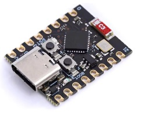
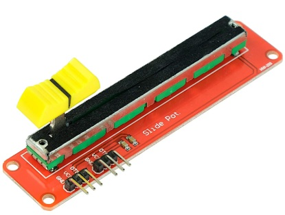
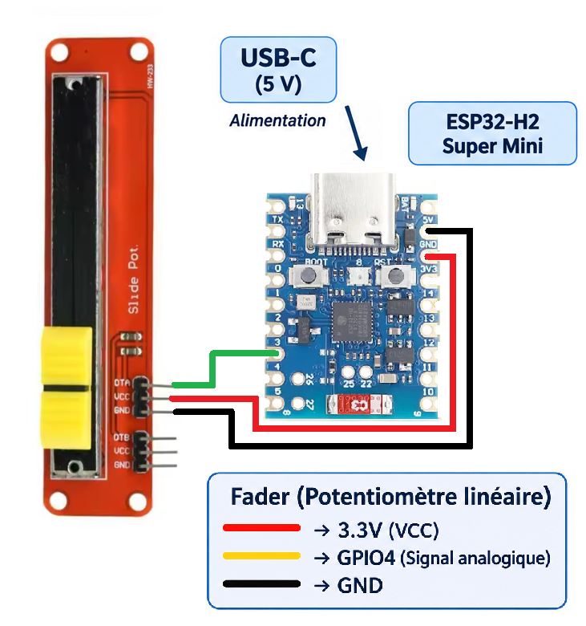

# ESP32-H2 SuperMini Zigbee : contrôler la luminosité d'une lampe avec un potentiomètre ou un fader

Ce tutoriel montre comment créer un composant Zigbee avec un **ESP32-H2 SuperMini** capable de transmettre la position d'un potentiomètre ou d'un fader analogique vers Home Assistant.

Nous allons créer un variateur de luminosité physique à l'aide d'un fader (potentiomètre linéaire) HW-233 et d'un ESP32-H2 Super Mini.

L'objectif est de déplacer le curseur du fader pour faire varier en temps réel la luminosité d'une ampoule Zigbee pilotée par Home Assistant.


La position du potentiomètre est mesurée sur une entrée analogique (ADC) de l'ESP32-H2, convertie en une valeur comprise entre **0 et 100 %**, puis envoyée via Zigbee à une passerelle/coordinatrice utilisant **Zigbee2MQTT**.

Home Assistant récupère ensuite cette valeur et peut l'utiliser pour contrôler progressivement l'intensité lumineuse d'une lampe compatible avec le variateur.

Le fonctionnement est le suivant :
1. Le fader fournit une tension analogique en fonction de la position de son curseur.
2. L'ESP32-H2 mesure cette tension sur une entrée analogique.
3. Le programme convertit la mesure en un pourcentage compris entre 0 et 100 %.
4. L'ESP32-H2 transmet cette valeur via Zigbee.
5. Zigbee2MQTT récupère la valeur et la transmet à Home Assistant.
6. Une automatisation Home Assistant adapte la luminosité de l'ampoule.

> \[!IMPORTANT\] L'ESP32-H2 ne publie pas directement en MQTT. Il communique en **Zigbee** avec la coordinatrice. C'est **Zigbee2MQTT** qui convertit ensuite les messages Zigbee en messages MQTT pour Home Assistant.
>
> Le composant utilise le cluster Zigbee **Analog Input**. Selon la prise en charge de ce cluster par Zigbee2MQTT, un external converter peut être nécessaire pour exposer correctement la valeur dans Home Assistant.

# 📺 Vidéo

Lien Youtube :
[https://www.youtube.com/@Baronnix](https://www.youtube.com/@Baronnix)

# Réalisation du périphérique et intégration dans Home Assistant

## 1. Architecture

``` text
Potentiomètre / Fader
        │
        │ Signal analogique
        ▼
ESP32-H2 SuperMini
        │
        │ Zigbee 3.0 / IEEE 802.15.4
        ▼
Coordinateur Zigbee
        │
        │ Zigbee2MQTT
        ▼
Broker MQTT
        │
        ▼
Home Assistant
        │
        │ Automatisation
        ▼
Lampe connectée
        │
        ▼
Réglage de luminosité
```

## 2. Fonctionnement attendu

Le firmware gère deux fonctions principales :

1.  **Mode appairage**
    -   L'ESP32-H2 cherche un réseau Zigbee ouvert.
    -   Zigbee2MQTT doit avoir l'option **Appairage autorisé** activée.
    -   Une fois appairé, le composant apparaît dans Zigbee2MQTT.
2.  **Mode fonctionnement**
    -   Un potentiomètre ou un fader est raccordé à une entrée analogique de l'ESP32-H2.
    -   La position est mesurée périodiquement avec le convertisseur ADC.
    -   La mesure est convertie en une valeur comprise entre 0 et 100 %.
    -   Un filtrage logiciel permet de stabiliser les mesures.
    -   La valeur est exposée avec un cluster Zigbee **Analog Input**.
    -   Une publication Zigbee est réalisée lorsque la position change suffisamment.
    -   Un appui long sur le bouton `BOOT` réinitialise la configuration Zigbee et relance l'appairage.

L'objectif est de pouvoir déplacer le potentiomètre et de retrouver immédiatement la position correspondante dans Home Assistant.

Cette valeur pourra ensuite être utilisée dans une automatisation pour régler la luminosité d'une lampe.

## 3. Matériel nécessaire

- Une carte **ESP32-H2 SuperMini** avec connecteur USB-C et 4 Mo de
    flash.



- Un potentiomètre linéaire ou un fader analogique (HW-233 utilisé dans ce tutoriel)



- Une plaque d’essai et des fils de connexion.  
- Un câble USB-C prenant en charge les données.
- Home Assistant avec une coordinatrice Zigbee et Zigbee2MQTT.
- Arduino IDE 2.x avec le core Espressif ESP32.

Tutoriels utiles: 
- [02 - Installation Home Assistant](https://www.youtube.com/watch?v=F-s3jXZxmUI)
- [04 - Zigbee Installation et Utilisation](https://www.youtube.com/watch?v=F-s3jXZxmUI)
- [01 - ESP32 Arduino - USB-C MIDI Controleur - Premiere Programmation](https://www.youtube.com/watch?v=1if2j6FiMQ4)

## 3.1 Broches utiles et câblage de l'ESP32-H2 SuperMini

| Fonction | Broche | Remarque |
|---|---|---|
| Bouton BOOT | GPIO9 | Actif à l’état bas, utilisé pour le Factory Reset |
| Potentiomètre | GPIO4 | Entrée analogique ADC à vérifier sur la carte utilisée |
| USB-C natif | USB Serial/JTAG | Programmation et moniteur série |

### Câblage du potentiomètre

Un potentiomètre classique possède trois connexions :

| Potentiomètre | ESP32-H2 |
|---|---|
| Première borne | 3.3V |
| Borne centrale (curseur) | GPIO4 |
| Dernière borne | GND |

Le principe est simple : la tension présente sur la borne centrale varie en fonction de la position du potentiomètre.

-   Position minimale : tension proche de 0 V.
-   Position maximale : tension proche de 3,3 V.
-   Position intermédiaire : tension comprise entre 0 et 3,3 V.

> \[!WARNING\] Ne jamais appliquer 5 V sur une entrée analogique de l'ESP32-H2. Le potentiomètre doit être alimenté en 3,3 V.
>
> Vérifier également que GPIO4 est bien disponible et compatible ADC sur votre modèle de carte. Vérifier la documentation de la carte et le brochage de la puce avant le câblage.



## 3.2 Dépendances et versions

-   Arduino IDE : 2.3.10
-   Cartes :
    -   esp32 par Espressif Systems : 3.3.12

## 4. Préparation d'Arduino IDE

### 4.1 Installer le support ESP32

Dans **Arduino IDE \> Fichier \> Préférences**, ajouter l'URL suivante
dans **Additional Boards Manager URLs** :

``` text
https://espressif.github.io/arduino-esp32/package_esp32_index.json
```

Puis ouvrir **Outils \> Carte \> Gestionnaire de cartes**, rechercher
`esp32` et installer le package **esp32 by Espressif Systems**.

### 4.2 Sélectionner les options Zigbee

Dans le menu **Tools** :

-   **Board** : `ESP32H2 Dev Module`
-   **USB CDC On Boot** : `Enabled`
-   **Upload Mode** : `UART0 / Hardware CDC` si cette option est proposée
-   **Zigbee mode** : `Zigbee ED (end device)`
-   **Partition Scheme** : `Zigbee 4MB with spiffs`
-   **Erase All Flash Before Sketch Upload** : `Enabled` pour le premier flash ou après un problème d'appairage
-   **Core Debug Level** : `Info` ou `Verbose` pendant les tests

> Les noms des menus peuvent légèrement varier selon la version du core Arduino ESP32.

## 5. Calibration du fader

### 5.1 Pourquoi calibrer le fader ?

La conversion analogique de l'ESP32-H2 ne donne pas nécessairement une valeur allant exactement de 0 à 4095 sur toute la course mécanique du fader.

Il est donc préférable de mesurer les deux valeurs réellement obtenues :

- La valeur ADC lorsque le curseur est en butée basse.
- La valeur ADC lorsque le curseur est en butée haute.

Ces deux valeurs seront ensuite utilisées dans le programme Zigbee final.

### 5.2 Sketch de calibration

Créez un nouveau sketch Arduino nommé `calibration_fader.ino` et téléversez le code suivant :

```cpp
#include <Arduino.h>

#define POTENTIOMETER_PIN 4
#define ADC_SAMPLES 64

int lireADC() {
  uint32_t total = 0;

  for (int i = 0; i < ADC_SAMPLES; i++) {
    total += analogRead(POTENTIOMETER_PIN);
    delay(2);
  }

  return total / ADC_SAMPLES;
}

void setup() {
  Serial.begin(115200);
  delay(1500);

  analogReadResolution(12);

  Serial.println();
  Serial.println("=== CALIBRATION DU FADER ===");
  Serial.println("Placer le curseur en butee basse puis envoyer : m");
  Serial.println("Placer le curseur en butee haute puis envoyer : M");
}

void loop() {
  static uint32_t lastPrint = 0;

  if (millis() - lastPrint >= 400) {
    lastPrint = millis();
    Serial.printf("Valeur ADC : %d\n", lireADC());
  }

  while (Serial.available()) {
    char command = Serial.read();

    if (command == 'm') {
      int rawMin = lireADC();
      Serial.printf("ADC_RAW_MIN = %d\n", rawMin);
    }

    if (command == 'M') {
      int rawMax = lireADC();
      Serial.printf("ADC_RAW_MAX = %d\n", rawMax);
    }
  }
}
```

### 5.3 Procédure de calibration

1. Téléversez le sketch de calibration sur l'ESP32-H2.
2. Ouvrez le moniteur série à 115200 bauds.
3. Placez le curseur du fader en butée basse.
4. Envoyez la lettre `m` dans le moniteur série.
5. Notez la valeur affichée sous la forme `ADC_RAW_MIN = ...`.
6. Placez le curseur en butée haute.
7. Envoyez la lettre `M`.
8. Notez la valeur affichée sous la forme `ADC_RAW_MAX = ...`.

Conservez ces deux valeurs : elles seront utilisées dans le programme final.

**Important :** si les valeurs sont inversées, le sens de variation du curseur sera inversé. Il est possible de corriger cela en inversant les valeurs MIN et MAX dans le programme final, ou en inversant le calcul.

## 5. Programme Zigbee final

Le programme final doit effectuer les opérations suivantes :

- Lire régulièrement la valeur analogique du fader.
- Convertir cette mesure en pourcentage.
- Exposer cette valeur à travers le cluster Zigbee Analog Input (cluster 0x000C).
- Transmettre les nouvelles valeurs à Zigbee2MQTT.
- Éviter les transmissions inutiles lorsque la position du fader ne change pas significativement.

### 5.1 Valeurs de calibration

Dans le programme final, remplacez les valeurs suivantes par celles obtenues lors de votre calibration :

```cpp
#define ADC_RAW_MIN 125
#define ADC_RAW_MAX 3337
```

Les valeurs ci-dessus sont des exemples : elles ne doivent pas être conservées sans avoir effectué votre propre calibration.

### 5.2 Code complet

Créer un nouveau sketch, par exemple `esp32_h2_fader_zigbee.ino`, puis copier le code suivant :

``` cpp

#include <Arduino.h>
#include "Zigbee.h"

// =====================================================
// CONFIGURATION MATERIELLE
// =====================================================

#define SENSOR_ENDPOINT       10
#define POTENTIOMETER_PIN     4
#define FACTORY_RESET_PIN     9

// =====================================================
// CALIBRATION DU FADER
// =====================================================

// IMPORTANT : remplacer par les valeurs obtenues
// avec le programme de calibration.

#define ADC_RAW_MIN           125
#define ADC_RAW_MAX           3337

// =====================================================
// PARAMETRES DE LECTURE ET DE TRANSMISSION
// =====================================================

#define ADC_SAMPLES           8

// Lecture du fader toutes les 50 ms
#define READ_INTERVAL_MS      50

// Variation minimale pour transmettre une nouvelle valeur
#define REPORT_THRESHOLD      1.0f

// Transmission périodique de sécurité
#define MAX_REPORT_INTERVAL_MS 30000

// Appui long pour réinitialiser Zigbee
#define FACTORY_RESET_HOLD_MS 5000

// =====================================================
// OBJET ZIGBEE
// =====================================================

ZigbeeAnalog potentiometerSensor(SENSOR_ENDPOINT);

// =====================================================
// VARIABLES
// =====================================================

float currentPercentage = 0.0f;
float lastReportedPercentage = -1000.0f;

uint32_t lastReadTime = 0;
uint32_t lastReportTime = 0;
uint32_t buttonPressTime = 0;

bool buttonWasPressed = false;
bool zigbeeConnected = false;

// =====================================================
// LECTURE DU FADER
// =====================================================

float readPotentiometer() {

  uint32_t total = 0;

  // Moyenne de plusieurs mesures pour stabiliser l'ADC
  for (uint8_t i = 0; i < ADC_SAMPLES; i++) {
    total += analogRead(POTENTIOMETER_PIN);
  }

  float average = (float)total / ADC_SAMPLES;

  return average;
}

// =====================================================
// CONVERSION ADC VERS POURCENTAGE
// =====================================================

float convertToPercentage(float rawValue) {

  if (ADC_RAW_MAX <= ADC_RAW_MIN) {
    return 0.0f;
  }

  float percentage =
    ((rawValue - ADC_RAW_MIN) * 100.0f) /
    (ADC_RAW_MAX - ADC_RAW_MIN);

  // Limitation entre 0 et 100 %
  percentage = constrain(percentage, 0.0f, 100.0f);

  return percentage;
}

// =====================================================
// GESTION DE LA REINITIALISATION ZIGBEE
// =====================================================

void checkFactoryResetButton() {

  bool pressed = (digitalRead(FACTORY_RESET_PIN) == LOW);

  if (pressed && !buttonWasPressed) {

    buttonPressTime = millis();
    buttonWasPressed = true;

  }

  if (!pressed && buttonWasPressed) {

    buttonWasPressed = false;

  }

  if (pressed && buttonWasPressed) {

    if (millis() - buttonPressTime >= FACTORY_RESET_HOLD_MS) {

      Serial.println();
      Serial.println("Reinitialisation Zigbee...");
      Serial.println("Effacement de la configuration reseau.");

      delay(500);

      Zigbee.factoryReset();

      delay(1000);

      ESP.restart();
    }
  }
}

// =====================================================
// TRANSMISSION DE LA VALEUR ZIGBEE
// =====================================================

void reportPercentage(float percentage) {

  // Mise à jour de la valeur du cluster Analog Input
  potentiometerSensor.setAnalogInput(percentage);

  bool success = potentiometerSensor.reportAnalogInput();

  if (success) {

    lastReportedPercentage = percentage;
    lastReportTime = millis();

    Serial.print("Valeur Zigbee envoyee : ");
    Serial.print(percentage, 1);
    Serial.println(" %");

  } else {

    Serial.println("Erreur lors de la transmission Zigbee");

  }
}

// =====================================================
// SETUP
// =====================================================

void setup() {

  Serial.begin(115200);
  delay(1000);

  Serial.println();
  Serial.println("=================================");
  Serial.println("   FADER ZIGBEE ESP32-H2");
  Serial.println("=================================");

  // Configuration de l'entrée analogique
  analogReadResolution(12);

  pinMode(POTENTIOMETER_PIN, INPUT);

  // Configuration du bouton de réinitialisation
  pinMode(FACTORY_RESET_PIN, INPUT_PULLUP);

  // ---------------------------------------------------
  // CONFIGURATION DU CLUSTER ANALOG INPUT
  // ---------------------------------------------------

  potentiometerSensor.setManufacturerAndModel(
    "Baronnix",
    "Fader Zigbee ESP32-H2"
  );

  // Ajout du cluster Analog Input
  potentiometerSensor.addAnalogInput();

  // Type de donnée : pourcentage
  potentiometerSensor.setAnalogInputApplication(
    ESP_ZB_ZCL_AI_PERCENTAGE_OTHER
  );

  potentiometerSensor.setAnalogInputDescription(
    "Position du fader"
  );

  // Résolution : 1 %
  potentiometerSensor.setAnalogInputResolution(1.0f);

  // Plage de valeurs : 0 à 100
  potentiometerSensor.setAnalogInputMinMax(0.0f, 100.0f);

  // Configuration du reporting Zigbee
  potentiometerSensor.setAnalogInputReporting(
    1,
    30,
    REPORT_THRESHOLD
  );

  // Enregistrement de l'endpoint
  Zigbee.addEndpoint(&potentiometerSensor);

  // ---------------------------------------------------
  // DEMARRAGE ZIGBEE
  // ---------------------------------------------------

  Serial.println("Demarrage du reseau Zigbee...");

  
  if (!Zigbee.begin(ZIGBEE_END_DEVICE)) {  //ZIGBEE_END_DEVICE or ZIGBEE_ROUTER

    Serial.println("Erreur de demarrage Zigbee !");
    delay(1000);
    ESP.restart();

  }

  Serial.println("Zigbee demarre.");
  Serial.println("Attente de la connexion au coordinateur...");

  while (!Zigbee.connected()) {

    Serial.print(".");
    delay(200);

    checkFactoryResetButton();

  }

  zigbeeConnected = true;

  Serial.println();
  Serial.println("Connexion Zigbee etablie !");

  // Lecture initiale du fader
  currentPercentage = convertToPercentage(
    readPotentiometer()
  );

  // Transmission de la première valeur
  reportPercentage(currentPercentage);

}

// =====================================================
// LOOP
// =====================================================

void loop() {

  // Gestion du bouton de réinitialisation
  checkFactoryResetButton();

  // Vérification de la connexion Zigbee
  if (!zigbeeConnected || !Zigbee.connected()) {
    delay(10);
    return;
  }

  // Lecture périodique du fader
  if (millis() - lastReadTime >= READ_INTERVAL_MS) {

    lastReadTime = millis();

    float rawValue = readPotentiometer();

    currentPercentage = convertToPercentage(rawValue);

    Serial.print("ADC : ");
    Serial.print(rawValue, 0);

    Serial.print(" | Position : ");
    Serial.print(currentPercentage, 1);

    Serial.println(" %");

    // Mise à jour de la valeur locale du cluster
    potentiometerSensor.setAnalogInput(currentPercentage);

    // Vérification du seuil de variation
    bool valueChanged =
      abs(currentPercentage - lastReportedPercentage)
      >= REPORT_THRESHOLD;

    // Transmission périodique même si la valeur ne change pas
    bool periodicReport =
      millis() - lastReportTime >= MAX_REPORT_INTERVAL_MS;

    if (valueChanged || periodicReport) {

      reportPercentage(currentPercentage);

    }
  }

  delay(5);
}
```

## 6. Compilation et flash

1.  Connecter l'ESP32-H2 SuperMini avec un câble USB-C prenant en charge les données.
2.  Sélectionner la bonne configuration dans **Outils** (voir section 4.2)
3.  Passer l'ESP32-H2 en mode programmation, maintenir `BOOT`, appuyer brièvement sur `RST`, relâcher `RST`, puis relâcher `BOOT`.
4.  Cliquer sur **Téléverser**.
5.  Ouvrir le **Serial Monitor** à `115200 bauds`.
6.  Vérifier que les messages de démarrage apparaissent.

## 7. Appairage avec Zigbee2MQTT

1.  Ouvrir l'interface Zigbee2MQTT.
2.  Cliquer sur **Appairage autorisé**.
3.  Redémarrer l'ESP32-H2, ou maintenir `BOOT` pendant environ cinq secondes pour effacer l'ancien réseau.
4.  Attendre la fin de l'interview Zigbee.
5.  Renommer le composant, par exemple `esp32_h2_fader`.

Le composant expose un cluster **Analog Input** contenant la valeur analogique normalisée.

La valeur transmise représente le pourcentage de déplacement du potentiomètre :

| Position     | Valeur transmise |
| ------------------- | ------------------ |
| Minimum | 0 % |
| 1/4 de course | 25 % |
| Milieu | 50 % |
| 3/4 de course | 75 % |
| Maximum | 100 % |

> La reconnaissance du cluster Analog Input dépend du convertisseur Zigbee2MQTT. Si le composant est reconnu mais que la valeur n'est pas exposée, il faudra utiliser un external converter adapté.

## 8. Affichage dans Home Assistant

Une fois le périphérique correctement reconnu dans Zigbee2MQTT, la valeur numérique doit être disponible dans Home Assistant.

Il faut identifier l'entité correspondant à la valeur du fader.

Par exemple :

```text
sensor.esp32_h2_fader
```

Le nom réel dépendra de votre configuration Zigbee2MQTT et de la découverte MQTT.

Vérifiez dans **Outils de développement > États** que la valeur évolue bien entre 0 et 100 lorsque vous déplacez le curseur.

Cette entité pourra ensuite être utilisée dans une automatisation Home Assistant.

### 8.1 Création d'une automatisation pour contrôler une lampe

Nous allons maintenant créer une automatisation qui adapte la luminosité d'une ampoule Zigbee en fonction de la valeur reçue du fader.

Le comportement souhaité est le suivant :

- À 0 %, l'ampoule s'éteint.
- Entre 1 et 100 %, la luminosité de l'ampoule suit la position du fader.
- Chaque nouvelle valeur reçue déclenche une mise à jour de la luminosité.

On a ajouté deux paramètres pour définir la plage utile du fader :
- Seuil minimum du fader : 15 % → ampoule éteinte (0 %).
- Seuil maximum du fader : 80 % → ampoule à 100 %.
- Entre 15 et 80 %, la luminosité évolue de manière linéaire.
Il est possible de modifier ces deux valeurs directement dans l'automatisation.

### 8.1 YAML de l'automatisation

Dans Home Assistant, créez une nouvelle automatisation et passez en mode YAML.

``` yaml
alias: Variateur Zigbee - Fader ESP32-H2
description: Variateur avec seuils minimum et maximum réglables
mode: restart

triggers:
  - trigger: state
    entity_id: sensor.fader_lampe_position_du_fader

conditions: []

actions:
  - variables:
      # Seuils réglables du fader
      fader_min: 10
      fader_max: 90

      # Position actuelle du fader
      fader: "{{ states('sensor.fader_lampe_position_du_fader') | float(0) }}"

      # Calcul de la luminosité
      niveau: >
        
          0
        
          100
        
          {{ ((fader | float - fader_min | float) * 100 /
              (fader_max | float - fader_min | float)) | round(0) | int }}
        

  - choose:
      # Extinction sous le seuil minimum
      - conditions:
          - condition: template
            value_template: "{{ niveau | int == 0 }}"
        sequence:
          - action: light.turn_off
            target:
              entity_id: light.lampe_buzzer

    # Variation linéaire entre les deux seuils
    default:
      - action: light.turn_on
        target:
          entity_id: light.lampe_buzzer
        data:
          brightness_pct: "{{ niveau | int }}"
          transition: 0.1
```

### 8.2 Adapter les entités et seuils

Les éléments suivants doivent être remplacés par les identifiants réels de votre installation :

- `sensor.esp32_h2_fader` : l'entité contenant la valeur numérique du fader.
- `light.ma_lampe_zigbee` : l'entité correspondant à votre ampoule Zigbee.
- `fader_min` : Seuil minimum du fader
- `fader_max` : Seuil maximum du fader

La transition de `0.1` seconde permet de rendre les changements de luminosité plus fluides.

### 8.3 Fonctionnement de l'automatisation

Lorsque la valeur du capteur change, Home Assistant récupère le pourcentage.

Si la valeur est égale à zéro, l'ampoule est éteinte.

Avec les seuils 15 % et 80 %, voici le comportement :


Cette automatisation suppose que la lampe accepte les commandes de variation et que la valeur du capteur est correctement exposée.

Le mode `restart` permet de relancer l'automatisation à chaque nouvelle valeur reçue.

La réactivité réelle dépend notamment de la fréquence de lecture et de transmission Zigbee configurée dans le firmware.

## 9. Dépannage

### 9.1 Le fader ne varie pas de 0 à 100 %

Vérifiez les valeurs de calibration :

- `ADC_RAW_MIN`
- `ADC_RAW_MAX`

Elles doivent correspondre aux valeurs mesurées aux deux extrémités de la course mécanique.

### 9.2 La valeur varie dans le mauvais sens

Inversez les valeurs MIN et MAX ou inversez le calcul du pourcentage.

### 9.3 Le périphérique apparaît dans Zigbee2MQTT, mais aucune valeur n'est disponible

Vérifiez que le cluster Analog Input est correctement exposé et que Zigbee2MQTT dispose d'un convertisseur adapté si nécessaire.

### 9.4 Home Assistant ne reçoit pas la valeur

Vérifiez :

- La présence de la valeur dans Zigbee2MQTT.
- La découverte MQTT dans Home Assistant.
- Le nom réel de l'entité.
- L'état du capteur dans les outils de développement de Home Assistant.

### 9.5 L'ampoule ne réagit pas

Vérifiez que l'identifiant `light.ma_lampe_zigbee` correspond bien à votre ampoule et que celle-ci accepte le contrôle de luminosité.

## 10. Résultat final

Nous avons maintenant un variateur physique Zigbee basé sur un ESP32-H2 et un fader linéaire.

Le fader permet de piloter la luminosité d'une ampoule Zigbee directement depuis Home Assistant, sans avoir besoin d'un variateur Zigbee commercial.

Ce montage peut également servir de base à d'autres commandes analogiques :

- Réglage du volume.
- Contrôle de la température de consigne.
- Réglage de la vitesse d'un ventilateur.
- Contrôle de l'intensité d'un éclairage.
- Création d'interfaces physiques personnalisées pour Home Assistant.

# Explication du programme Arduino – Variateur Zigbee avec ESP32-H2

## 11. Présentation générale

Ce programme permet de transformer un fader (potentiomètre linéaire) HW-233 en commande physique Zigbee utilisable dans Home Assistant.

L'ESP32-H2 lit la position du curseur du fader sur une entrée analogique, convertit cette mesure en pourcentage, puis transmet cette valeur au réseau Zigbee.

Home Assistant peut ensuite exploiter cette information pour piloter différents équipements : ampoule, variateur, ventilateur, volume sonore ou tout autre équipement compatible.

### 11.1 Architecture du système

Le fonctionnement global est le suivant :

1. Le fader HW-233 fournit une tension analogique en fonction de la position de son curseur.
2. L'ESP32-H2 mesure cette tension sur son entrée GPIO4.
3. Le programme effectue plusieurs mesures pour stabiliser la lecture.
4. La valeur analogique est convertie en pourcentage, entre 0 et 100 %.
5. L'ESP32-H2 met à jour son cluster Zigbee Analog Input.
6. La nouvelle valeur est transmise à Zigbee2MQTT.
7. Home Assistant récupère cette valeur et peut l'utiliser dans une automatisation.

## 12. Les bibliothèques utilisées

```cpp
#include <Arduino.h>
#include "Zigbee.h"
```

### 12.1 Arduino.h

Cette bibliothèque fournit les fonctions classiques de programmation Arduino :

- `pinMode()` : configuration des broches.
- `digitalRead()` : lecture d'une entrée numérique.
- `analogRead()` : lecture d'une entrée analogique.
- `millis()` : temps écoulé depuis le démarrage.
- `delay()` : temporisation.
- `Serial` : communication avec le moniteur série.

### 12.2 Zigbee.h

Cette bibliothèque permet d'utiliser le contrôleur Zigbee intégré à l'ESP32-H2.

Elle permet notamment de :

- Créer un périphérique Zigbee.
- Déclarer des endpoints.
- Ajouter des clusters Zigbee.
- Transmettre des valeurs.
- Rejoindre un réseau Zigbee.
- Réinitialiser la configuration réseau.

Dans notre projet, nous utilisons le type de périphérique `ZigbeeAnalog` et le cluster standard **Analog Input (0x000C)**.

Ce cluster permet de représenter une valeur analogique sous forme numérique et de la rendre accessible aux autres équipements Zigbee.

## 13. Configuration matérielle

```cpp
#define SENSOR_ENDPOINT       10
#define POTENTIOMETER_PIN     4
#define FACTORY_RESET_PIN     9
```

Ces constantes définissent les broches et l'identifiant utilisés par le programme.

| Constante | Valeur | Fonction |
|---|---:|---|
| `SENSOR_ENDPOINT` | 10 | Identifiant de l'endpoint Zigbee |
| `POTENTIOMETER_PIN` | GPIO4 | Entrée analogique du fader |
| `FACTORY_RESET_PIN` | GPIO9 | Bouton de réinitialisation Zigbee |

### 13.1 Qu'est-ce qu'un endpoint Zigbee ?

Un endpoint est un point de terminaison logique d'un équipement Zigbee.

Un même appareil physique peut posséder plusieurs endpoints, chacun pouvant proposer des fonctionnalités différentes.

Ici, nous utilisons l'endpoint 10 pour exposer notre commande analogique.

Le numéro 10 est un choix de configuration : il ne correspond pas directement à une broche physique.

### 13.2 Branchement du fader

| HW-233 | ESP32-H2 Super Mini |
|---|---|
| VCC | 3V3 |
| GND | GND |
| SIG | GPIO4 |

Le module est alimenté en 3,3 V afin de garantir que la tension envoyée sur l'entrée analogique reste compatible avec l'ESP32-H2.

---

## 14. Calibration du fader

```cpp
#define ADC_RAW_MIN           125
#define ADC_RAW_MAX           3337
```

Ces deux constantes correspondent aux valeurs analogiques mesurées lorsque le curseur du fader se trouve à ses deux extrémités.

La valeur ADC est une mesure numérique de la tension présente sur l'entrée analogique.

Avec une résolution de 12 bits, la conversion théorique peut produire des valeurs comprises entre 0 et 4095.

Cependant, le fader n'utilise pas nécessairement toute cette plage.

Il faut donc effectuer une calibration.

### 14.1 ADC_RAW_MIN

Correspond à la valeur ADC mesurée lorsque le curseur est en butée basse.

### 14.2 ADC_RAW_MAX

Correspond à la valeur ADC mesurée lorsque le curseur est en butée haute.

**Important :** les valeurs 125 et 3337 sont des exemples. Elles doivent être remplacées par les valeurs réellement obtenues lors de la calibration de votre montage.

Cette calibration permet d'utiliser toute la course mécanique du fader pour représenter une plage comprise entre 0 et 100 %.

## 15. Paramètres de lecture et de transmission

```cpp
#define ADC_SAMPLES           8
#define READ_INTERVAL_MS      50
#define REPORT_THRESHOLD      1.0f
#define MAX_REPORT_INTERVAL_MS 30000
#define FACTORY_RESET_HOLD_MS 5000
```

Ces paramètres permettent de régler le comportement du programme.

| Paramètre | Valeur | Description |
|---|---:|---|
| `ADC_SAMPLES` | 8 | Nombre de mesures analogiques utilisées pour calculer une moyenne |
| `READ_INTERVAL_MS` | 50 ms | Intervalle entre deux lectures du fader |
| `REPORT_THRESHOLD` | 1 % | Variation minimale pour envoyer une nouvelle valeur Zigbee |
| `MAX_REPORT_INTERVAL_MS` | 30 000 ms | Délai maximal entre deux transmissions |
| `FACTORY_RESET_HOLD_MS` | 5 000 ms | Durée d'appui nécessaire pour réinitialiser Zigbee |

### 15.1 Pourquoi effectuer plusieurs mesures ADC ?

Une lecture analogique peut légèrement varier même si le curseur ne bouge pas.

Cela peut être dû à de petites fluctuations électriques ou aux caractéristiques du convertisseur analogique-numérique.

En effectuant huit mesures successives et en calculant leur moyenne, on obtient une valeur plus stable.

### 15.2 Pourquoi lire le fader toutes les 50 ms ?

50 ms correspondent à 20 lectures par seconde.

Cette fréquence permet de détecter rapidement les déplacements du curseur sans solliciter inutilement le microcontrôleur.

### 15.3 Pourquoi utiliser un seuil de transmission de 1 % ?

Il n'est pas nécessaire de transmettre une nouvelle valeur Zigbee pour chaque petite variation de mesure.

Avec un seuil de 1 %, le programme attend que la position du fader ait suffisamment changé avant d'envoyer une nouvelle information.

Cela limite le nombre de messages Zigbee et évite de surcharger inutilement le réseau.

### 15.4 Pourquoi effectuer une transmission périodique ?

Même lorsque le fader ne bouge pas, le programme transmet périodiquement sa valeur.

Cette transmission intervient au maximum toutes les 30 secondes.

Elle permet de republier la valeur courante, même si aucune variation n'a été détectée.

## 16. Création de l'objet Zigbee

```cpp
ZigbeeAnalog potentiometerSensor(SENSOR_ENDPOINT);
```

Cette instruction crée un objet Zigbee de type `ZigbeeAnalog`.

Cet objet représente notre périphérique analogique sur le réseau Zigbee.

Il utilise l'endpoint défini précédemment, soit le numéro 10.

C'est cet objet qui permettra de configurer le cluster Analog Input et de transmettre les valeurs du fader.

## 17. Les variables du programme

```cpp
float currentPercentage = 0.0f;
float lastReportedPercentage = -1000.0f;

uint32_t lastReadTime = 0;
uint32_t lastReportTime = 0;
uint32_t buttonPressTime = 0;

bool buttonWasPressed = false;
bool zigbeeConnected = false;
```

Ces variables permettent de conserver les informations nécessaires au fonctionnement du programme.

| Variable | Description |
|---|---|
| `currentPercentage` | Dernier pourcentage calculé à partir du fader |
| `lastReportedPercentage` | Dernier pourcentage transmis avec succès en Zigbee |
| `lastReadTime` | Date de la dernière lecture du fader |
| `lastReportTime` | Date de la dernière transmission Zigbee réussie |
| `buttonPressTime` | Date de début de l'appui sur le bouton |
| `buttonWasPressed` | Indique si le bouton est actuellement considéré comme appuyé |
| `zigbeeConnected` | Indique si la connexion Zigbee a été établie pendant le démarrage |

### Pourquoi initialiser lastReportedPercentage à -1000 ?

```cpp
float lastReportedPercentage = -1000.0f;
```

La valeur -1000 est volontairement éloignée de la plage normale du fader, qui se situe entre 0 et 100 %.

Cela garantit que la première valeur mesurée sera considérée comme différente de la dernière valeur transmise.

Le programme pourra ainsi envoyer immédiatement la position initiale du fader.

## 18. Lecture du fader

La fonction `readPotentiometer()` réalise la lecture analogique du fader.

```cpp
float readPotentiometer() {

  uint32_t total = 0;

  for (uint8_t i = 0; i < ADC_SAMPLES; i++) {
    total += analogRead(POTENTIOMETER_PIN);
  }

  float average = (float)total / ADC_SAMPLES;

  return average;
}
```

### 18.1 Étape 1 : initialiser le total

```cpp
uint32_t total = 0;
```

Cette variable va accumuler les différentes mesures ADC.

### 18.2 Étape 2 : effectuer plusieurs lectures

```cpp
for (uint8_t i = 0; i < ADC_SAMPLES; i++) {
  total += analogRead(POTENTIOMETER_PIN);
}
```

Le programme réalise huit lectures successives sur GPIO4.

Chaque mesure est ajoutée à la variable `total`.

### 18.3 Étape 3 : calculer la moyenne

```cpp
float average = (float)total / ADC_SAMPLES;
```

La somme des huit mesures est divisée par huit.

On obtient ainsi une valeur analogique moyenne.

### 18.4 Étape 4 : retourner la mesure

```cpp
return average;
```

La fonction retourne la valeur ADC moyenne.

Cette valeur sera ensuite convertie en pourcentage.

## 19. Conversion de la valeur ADC en pourcentage

La fonction `convertToPercentage()` transforme la valeur analogique en une position comprise entre 0 et 100 %.

```cpp
float convertToPercentage(float rawValue) {

  if (ADC_RAW_MAX <= ADC_RAW_MIN) {
    return 0.0f;
  }

  float percentage =
    ((rawValue - ADC_RAW_MIN) * 100.0f) /
    (ADC_RAW_MAX - ADC_RAW_MIN);

  percentage = constrain(percentage, 0.0f, 100.0f);

  return percentage;
}
```

### 19.1 Vérification de la calibration

```cpp
if (ADC_RAW_MAX <= ADC_RAW_MIN) {
  return 0.0f;
}
```

Cette condition vérifie que les valeurs de calibration sont cohérentes.

Si la valeur maximale est inférieure ou égale à la valeur minimale, le calcul ne peut pas être effectué correctement.

La fonction retourne alors 0 %.

### 19.2 Calcul du pourcentage

```cpp
float percentage =
  ((rawValue - ADC_RAW_MIN) * 100.0f) /
  (ADC_RAW_MAX - ADC_RAW_MIN);
```

Cette formule réalise une interpolation linéaire entre les deux valeurs de calibration.

Exemple avec :

- ADC_RAW_MIN = 125
- ADC_RAW_MAX = 3337

| Valeur ADC | Pourcentage |
|---:|---:|
| 125 | 0 % |
| 928 | 25 % |
| 1731 | 50 % |
| 2534 | 75 % |
| 3337 | 100 % |

Les valeurs intermédiaires sont calculées proportionnellement.

### 19.3 Limitation de la plage

```cpp
percentage = constrain(percentage, 0.0f, 100.0f);
```

Cette fonction empêche le résultat de sortir de la plage autorisée.

Si la mesure ADC est inférieure à la valeur minimale de calibration, le résultat sera limité à 0 %.

Si elle dépasse la valeur maximale, le résultat sera limité à 100 %.

Cela évite d'envoyer des valeurs incohérentes sur le réseau Zigbee.

## 20. Gestion du bouton de réinitialisation Zigbee

La fonction `checkFactoryResetButton()` permet de réinitialiser la configuration réseau Zigbee en maintenant le bouton appuyé pendant cinq secondes.

### 20.1 Lecture du bouton

```cpp
bool pressed = (digitalRead(FACTORY_RESET_PIN) == LOW);
```

Le bouton est configuré en `INPUT_PULLUP`.

Cela signifie que :

- Au repos, l'entrée est à HIGH.
- Lorsque le bouton est appuyé et relié à GND, l'entrée passe à LOW.

C'est pourquoi le programme considère que le bouton est appuyé lorsque la lecture est égale à LOW.

### 20.2 Détection du début de l'appui

```cpp
if (pressed && !buttonWasPressed) {

  buttonPressTime = millis();
  buttonWasPressed = true;

}
```

Lorsque le programme détecte un nouvel appui, il mémorise l'heure de début grâce à `millis()`.

La variable `buttonWasPressed` permet de ne pas réinitialiser cette heure à chaque passage dans la boucle.

### 20.3 Détection du relâchement

```cpp
if (!pressed && buttonWasPressed) {

  buttonWasPressed = false;

}
```

Lorsque le bouton est relâché, l'état mémorisé est remis à zéro.

Un nouvel appui pourra alors être détecté.

### 20.4 Vérification de la durée de l'appui

```cpp
if (pressed && buttonWasPressed) {

  if (millis() - buttonPressTime >= FACTORY_RESET_HOLD_MS) {
```

Le programme calcule le temps écoulé depuis le début de l'appui.

Si ce temps dépasse cinq secondes, la réinitialisation est déclenchée.

### 20.5 Réinitialisation Zigbee

```cpp
Zigbee.factoryReset();

delay(1000);

ESP.restart();
```

La fonction `Zigbee.factoryReset()` efface la configuration réseau Zigbee enregistrée par le périphérique.

L'ESP32-H2 redémarre ensuite afin de repartir avec une configuration réseau vierge.

Il faudra alors autoriser à nouveau l'appairage dans Zigbee2MQTT.

**Attention :** cette opération nécessite un appui maintenu pendant cinq secondes. Un simple appui court ne réinitialise pas le réseau.

## 21. Transmission de la valeur en Zigbee

La fonction `reportPercentage()` est chargée de transmettre la position du fader.

```cpp
void reportPercentage(float percentage) {

  potentiometerSensor.setAnalogInput(percentage);

  bool success = potentiometerSensor.reportAnalogInput();

  if (success) {

    lastReportedPercentage = percentage;
    lastReportTime = millis();

    Serial.print("Valeur Zigbee envoyee : ");
    Serial.print(percentage, 1);
    Serial.println(" %");

  } else {

    Serial.println("Erreur lors de la transmission Zigbee");

  }
}
```

### 21.1 Mise à jour de la valeur du cluster

```cpp
potentiometerSensor.setAnalogInput(percentage);
```

Cette instruction met à jour la valeur de l'attribut `presentValue` du cluster Analog Input.

La valeur est exprimée en pourcentage.

### 21.2 Transmission Zigbee

```cpp
bool success = potentiometerSensor.reportAnalogInput();
```

Cette fonction demande la transmission de la valeur actuelle du cluster.

Elle retourne un booléen indiquant si l'opération a réussi selon la bibliothèque utilisée.

### 21.3 Mémorisation de la dernière valeur transmise

```cpp
if (success) {

  lastReportedPercentage = percentage;
  lastReportTime = millis();

}
```

La dernière valeur et l'heure de transmission ne sont mises à jour qu'en cas de succès.

Cela permet au programme de retenter une transmission si une précédente tentative a échoué.

### 21.4 Affichage dans le moniteur série

Le programme affiche la valeur envoyée pour faciliter le diagnostic.

Exemple :

```text
Valeur Zigbee envoyee : 52.4 %
```

## 22. Initialisation du programme : setup()

La fonction `setup()` est exécutée une seule fois au démarrage de l'ESP32-H2.

Elle prépare les entrées, configure le périphérique Zigbee et attend la connexion au coordinateur.

### 22.1 Initialisation du port série

```cpp
Serial.begin(115200);
delay(1000);
```

Le port série est initialisé à 115200 bauds.

Il permet de suivre le fonctionnement du programme depuis le moniteur série Arduino IDE.

### 22.2 Configuration de l'entrée analogique

```cpp
analogReadResolution(12);

pinMode(POTENTIOMETER_PIN, INPUT);
```

La résolution ADC est configurée sur 12 bits.

La mesure analogique utilise donc une plage théorique de 0 à 4095.

La broche GPIO4 est ensuite configurée en entrée.

### 22.3 Configuration du bouton

```cpp
pinMode(FACTORY_RESET_PIN, INPUT_PULLUP);
```

La broche GPIO9 est configurée avec une résistance de rappel interne au niveau haut.

Le bouton doit donc relier GPIO9 à GND lorsqu'il est appuyé.

### 22.4 Identification du périphérique

```cpp
potentiometerSensor.setManufacturerAndModel(
  "Baronnix",
  "Fader Zigbee ESP32-H2"
);
```

Ces informations permettent d'identifier le fabricant et le modèle du périphérique Zigbee.

Dans notre exemple :

- Fabricant : Baronnix
- Modèle : Fader Zigbee ESP32-H2

### 22.5 Ajout du cluster Analog Input

```cpp
potentiometerSensor.addAnalogInput();
```

Cette instruction ajoute le cluster Analog Input au périphérique.

Il s'agit du cluster Zigbee standard 0x000C.

Il est utilisé pour exposer une valeur analogique sous forme numérique.

### 22.6 Définition du type de donnée

```cpp
potentiometerSensor.setAnalogInputApplication(
  ESP_ZB_ZCL_AI_PERCENTAGE_OTHER
);
```

Cette instruction indique que la valeur analogique représente un pourcentage.

### 22.7 Description du capteur

```cpp
potentiometerSensor.setAnalogInputDescription(
  "Position du fader"
);
```

Cette description permet d'identifier la fonction du capteur.

### 22.8 Résolution

```cpp
potentiometerSensor.setAnalogInputResolution(1.0f);
```

La résolution indique ici un pas de 1 unité, soit 1 %.

### 22.9 Définition des valeurs minimales et maximales

```cpp
potentiometerSensor.setAnalogInputMinMax(0.0f, 100.0f);
```

La valeur publiée par le périphérique est comprise entre 0 et 100.

### 22.10 Configuration du reporting Zigbee

```cpp
potentiometerSensor.setAnalogInputReporting(
  1,
  30,
  REPORT_THRESHOLD
);
```

Cette instruction configure les paramètres de reporting du cluster.

Les paramètres correspondent à :

- Intervalle minimum : 1 seconde.
- Intervalle maximum : 30 secondes.
- Variation minimale : 1 %.

Le reporting permet au réseau Zigbee de gérer les notifications de changement de valeur.

### 22.11 Enregistrement de l'endpoint

```cpp
Zigbee.addEndpoint(&potentiometerSensor);
```

Cette instruction enregistre l'endpoint auprès de la pile Zigbee.

Le périphérique est maintenant déclaré et prêt à être démarré.

### 22.12 Démarrage Zigbee

```cpp
if (!Zigbee.begin(ZIGBEE_END_DEVICE)) {

  Serial.println("Erreur de demarrage Zigbee !");
  delay(1000);
  ESP.restart();

}
```

Cette instruction démarre la pile Zigbee en mode End Device.

Un End Device est un périphérique terminal du réseau Zigbee.

Contrairement à un Router, il ne relaie pas les communications des autres équipements.

C'est le rôle adapté à notre variateur, qui a uniquement besoin de transmettre la position du fader.

Le mode peut également être remplacé par `ZIGBEE_ROUTER` si l'on souhaite que l'ESP32-H2 participe au routage du réseau.

Le mode sélectionné dans Arduino IDE doit être cohérent avec la configuration de compilation du programme.

### 22.13 Attente de la connexion au coordinateur

```cpp
while (!Zigbee.connected()) {

  Serial.print(".");
  delay(200);

  checkFactoryResetButton();

}
```

Le programme attend que l'ESP32-H2 rejoigne le réseau Zigbee.

Tant que la connexion n'est pas établie, il affiche un point toutes les 200 ms dans le moniteur série.

La gestion du bouton de réinitialisation reste active pendant cette attente.

### 22.14 Première lecture et première transmission

```cpp
currentPercentage = convertToPercentage(
  readPotentiometer()
);

reportPercentage(currentPercentage);
```

Dès que la connexion Zigbee est établie :

1. Le programme lit le fader.
2. Il convertit la valeur ADC en pourcentage.
3. Il transmet immédiatement cette première valeur.

Cela permet à Home Assistant de connaître la position initiale du fader sans attendre son premier déplacement.

## 23. Boucle principale : loop()

La fonction `loop()` est exécutée en permanence après l'initialisation.

Elle gère la lecture du fader et les transmissions Zigbee.

### 23.1 Vérification du bouton de réinitialisation

```cpp
checkFactoryResetButton();
```

Le programme vérifie en permanence si le bouton est maintenu pendant cinq secondes.

### 23.2 Vérification de la connexion Zigbee

```cpp
if (!zigbeeConnected || !Zigbee.connected()) {
  delay(10);
  return;
}
```

Le programme vérifie que la connexion Zigbee est toujours disponible.

Si la connexion n'est pas établie, il suspend le traitement courant.

### 23.3 Lecture périodique du fader

```cpp
if (millis() - lastReadTime >= READ_INTERVAL_MS) {

  lastReadTime = millis();

  float rawValue = readPotentiometer();

  currentPercentage = convertToPercentage(rawValue);
```

Le programme vérifie si 50 ms se sont écoulées depuis la dernière lecture.

Si c'est le cas :

1. Il mémorise l'heure de lecture.
2. Il lit la valeur analogique.
3. Il convertit cette valeur en pourcentage.

L'utilisation de `millis()` permet de gérer cet intervalle sans bloquer le programme avec un long `delay()`.

### 23.4 Affichage des valeurs

```cpp
Serial.print("ADC : ");
Serial.print(rawValue, 0);

Serial.print(" | Position : ");
Serial.print(currentPercentage, 1);

Serial.println(" %");
```

Le moniteur série affiche la mesure ADC et le pourcentage correspondant.

Exemple :

```text
ADC : 1731 | Position : 50.0 %
```

Cela permet de vérifier que la calibration fonctionne correctement.

### 23.5 Mise à jour du cluster

```cpp
potentiometerSensor.setAnalogInput(currentPercentage);
```

La valeur locale du cluster Analog Input est mise à jour à chaque lecture.

Cela permet de conserver la dernière position mesurée dans l'objet Zigbee.

### 23.6 Détection d'un changement significatif

```cpp
bool valueChanged =
  abs(currentPercentage - lastReportedPercentage)
  >= REPORT_THRESHOLD;
```

Le programme compare la valeur actuelle avec la dernière valeur transmise avec succès.

Si la différence est supérieure ou égale à 1 %, une nouvelle transmission est nécessaire.

Exemple :

| Dernière valeur envoyée | Nouvelle valeur | Transmission |
|---:|---:|---|
| 20 % | 20,3 % | Non |
| 20 % | 20,8 % | Non |
| 20 % | 21 % | Oui |
| 21 % | 25 % | Oui |

Cela évite de multiplier les messages lorsque le fader bouge très légèrement.

### 23.7 Transmission périodique de sécurité

```cpp
bool periodicReport =
  millis() - lastReportTime >= MAX_REPORT_INTERVAL_MS;
```

Même si la position du fader ne change pas, le programme vérifie si 30 secondes se sont écoulées depuis la dernière transmission réussie.

Si c'est le cas, il transmet à nouveau la valeur.

### 23.8 Décision de transmettre

```cpp
if (valueChanged || periodicReport) {

  reportPercentage(currentPercentage);

}
```

Une nouvelle valeur est envoyée dans deux situations :

- Le fader a suffisamment changé de position.
- Le délai maximal de transmission est atteint.

Cela permet de concilier réactivité et limitation du trafic Zigbee.

### 23.9 Petite temporisation

```cpp
delay(5);
```

Cette temporisation de 5 ms évite de faire tourner la boucle principale inutilement rapidement.

Elle laisse également un peu de temps au système pour traiter les autres tâches.

## 24. Rôle du End Device dans ce projet

Le programme démarre avec :

```cpp
Zigbee.begin(ZIGBEE_END_DEVICE);
```

Le mode End Device est adapté à notre utilisation.

Le fader est une commande qui transmet des informations au réseau Zigbee, mais qui n'a pas besoin de relayer les communications des autres équipements.

Les différences principales sont :

| Fonction | End Device | Router |
|---|---|---|
| Rejoindre un réseau Zigbee | Oui | Oui |
| Transmettre la position du fader | Oui | Oui |
| Relayer les communications Zigbee | Non | Oui |
| Participer au maillage comme routeur | Non | Oui |
| Fonctionner sur batterie avec sommeil | Possible | Non, fonctionnement normalement permanent |

Le mode End Device est donc suffisant pour cette application.

Attention : le fait d'utiliser un End Device ne met pas automatiquement l'ESP32 en veille. Le programme présenté reste actif et continue de lire le fader toutes les 50 ms.

## 25. Résumé du fonctionnement

Le programme suit le cycle suivant :

1. Démarrage de l'ESP32-H2.
2. Configuration des entrées GPIO.
3. Initialisation du périphérique Zigbee.
4. Déclaration du cluster Analog Input.
5. Connexion au coordinateur Zigbee.
6. Lecture initiale du fader.
7. Transmission de la position initiale.
8. Lecture du fader toutes les 50 ms.
9. Conversion de la mesure ADC en pourcentage.
10. Transmission lorsqu'une variation d'au moins 1 % est détectée.
11. Transmission périodique toutes les 30 secondes.
12. Surveillance permanente du bouton de réinitialisation.

## 26. Paramètres facilement personnalisables

Les principales constantes à modifier selon votre installation sont regroupées au début du programme.

| Paramètre | Valeur par défaut | Utilité |
|---|---:|---|
| `POTENTIOMETER_PIN` | 4 | Broche de lecture du fader |
| `FACTORY_RESET_PIN` | 9 | Broche du bouton de réinitialisation |
| `ADC_RAW_MIN` | 125 | Valeur ADC en butée basse |
| `ADC_RAW_MAX` | 3337 | Valeur ADC en butée haute |
| `ADC_SAMPLES` | 8 | Nombre de mesures pour la moyenne |
| `READ_INTERVAL_MS` | 50 | Fréquence de lecture |
| `REPORT_THRESHOLD` | 1 % | Variation minimale pour transmettre |
| `MAX_REPORT_INTERVAL_MS` | 30000 | Transmission périodique |
| `FACTORY_RESET_HOLD_MS` | 5000 | Durée de l'appui long |

## 27. Résultat final

Nous disposons maintenant d'une commande physique Zigbee basée sur un fader et un ESP32-H2.

La position du curseur est convertie en une valeur numérique comprise entre 0 et 100 %, puis transmise au réseau Zigbee via le cluster Analog Input.

Cette valeur peut être récupérée dans Zigbee2MQTT et Home Assistant afin de piloter une ampoule, un variateur ou tout autre équipement compatible.

Le principe peut facilement être adapté à d'autres commandes analogiques et permettre de créer des interfaces physiques personnalisées pour la domotique.
