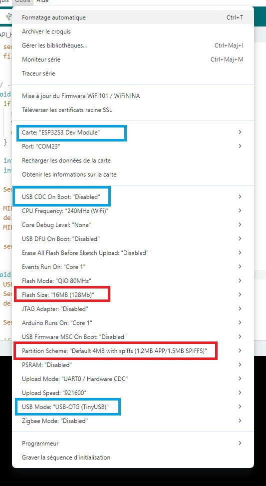
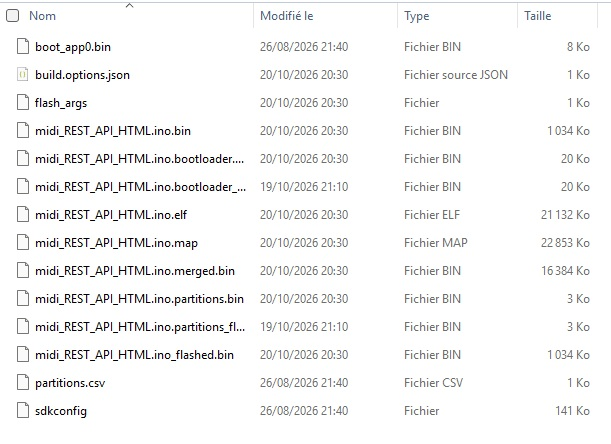
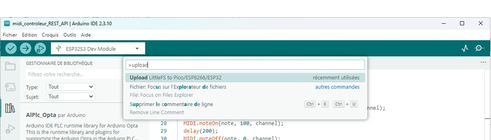

# 🚀 ESP32 / ESP32-S3 : Générer les BINAIRES et Flasher en 5 Minutes ! 

Dans ce tutoriel, nous allons apprendre à générer tous les fichiers binaires nécessaires à la distribution d'un projet ESP32 / ESP32-S3 développé avec l'IDE Arduino. Nous verrons comment récupérer le firmware compilé, créer l'image LittleFS, identifier les adresses de flash appropriées puis utiliser ESP Flash Download Tool pour programmer une carte ESP32 sans avoir besoin du code source ou de l'environnement Arduino.

À la fin de ce guide, vous serez capable de créer un véritable pack de déploiement composé des fichiers firmware.bin, bootloader.bin, partitions.bin et littlefs.bin, puis de reflasher rapidement un ESP32-S3 sur une nouvelle carte ou de partager votre projet sous forme de binaires prêts à l'emploi.

* ✅ Générer les binaires de votre projet Arduino
* ✅ Créer l'image LittleFS à partir du dossier data
* ✅ Comprendre les adresses de flash utilisées par l'ESP32
* ✅ Utiliser ESP Flash Download Tool comme un professionnel
* ✅ Déployer votre projet sur plusieurs cartes sans recompiler le code
* ✅ Distribuer votre firmware sans partager les sources Arduino

🚀 Une méthode particulièrement utile pour la production, les sauvegardes de projets, les tests sur plusieurs cartes ou le partage de vos créations ESP32 avec d'autres utilisateurs.

# 📺 Vidéo

Lien Youtube: [https://www.youtube.com/@Baronnix/playlists](https://www.youtube.com/@Baronnix/playlists)

# 📦 Prérequis

* Carte ESP32‑S2 / ESP32‑S3 compatible TinyUSB (Dans ce tutoriel on utilise la carte ESP32‑S3 DevKit C1)
* Câble USB‑C
* Un ordinateur (tutoriel réalisé sur Windows)
* Arduino IDE installé
* esp32 installé dans le gestionnaire de cartes (esp32 par Espressif Systems - 3.3.10)
* le driver CH340 est installé sur votre ordinateur (Tutoriel: https://github.com/Baronnix/Domotique-Home-Assistant/tree/main/09%20-%20ESPHome%20et%20ESP32#installation-du-driver-ch340)

Ce tutoriel repart du code final du tutoriel [07 - ESP32 Arduino - Interface Graphique](https://github.com/Baronnix/ESP32/tree/main/Controleur%20Midi/07%20-%20ESP32%20Arduino%20-%20Interface%20Graphique)

# Dependances et Versions

* Arduino IDE - 2.3.10
* Arduino Plugins:
  * arduino-littlefs-upload - 1.6.3
* Cartes:
  * esp32 par Espressif Systems - 3.3.11
* Librairies
  * Adafruit NeoPixel - 1.15.5
  * Async TCP par ESP32Async - 3.5.0
  * ESPAsyncWebServer par ESP32Async - 3.12.1

# 1. Compiler le firmware Arduino

## Ouvrir le projet

1. Ouvrir le projet dans Arduino IDE (Ouvre ton fichier .ino)
2. Configurer la carte dans Arduino IDE
    1. Choisir le type de carte:  Outils → Type de carte → ESP32S3 Dev Module
    2. Choisir le mode USB: Outils → USB Mode → USB OTG (TinyUSB)
    3. Choisir l'USB firmware: Outils → USB CDC On Boot → Disabled
    4. Choisir la taille de la mémoire Flash suivant votre ESP32
    5. Choisir Partition Schema: Default 4MB with spiffs


⚠️ Le schéma de partition choisi est important. Il devra rester identique lors du flashage (Par exemple : Default 4MB with spiffs).

## Compiler

1. Aller dans: Croquis → Vérifier/Compiler
2. Une fois terminé aller dans: Croquis → Export Compiled Binary

Arduino crée alors plusieurs fichiers binaires dans un dossier nommé "build" dans le dossier de ton projet.

Tu trouveras quelque chose comme :



Conserve ces fichiers.

## Détails des fichiers dans build

### Le fichier intéressant : flash_args

Il contient généralement quelque chose du genre :

```bash
--flash-mode dio --flash-freq 80m --flash-size 16MB  
0x0 midi_REST_API_HTML.ino.bootloader.bin  
0x8000 midi_REST_API_HTML.ino.partitions.bin  
0xe000 boot_app0.bin  
0x10000 midi_REST_API_HTML.ino.bin 
```

C'est lui qui donne exactement les adresses utilisées par Arduino pour le flash.

### Fichiers binaires utiles 

| Fichier | Detail | Adresse |
| ------- | ------ | ------- |
| midi_REST_API_HTML.ino.bootloader.bin | Bootloader | 0x0000 |
| midi_REST_API_HTML.ino.bin | Firmware principal | 0x10000 |
| boot_app0.bin  | boot_app0.bin est un fichier spécial lié au système OTA (Over-The-Air) des ESP32. | 0xe000 |
| midi_REST_API_HTML.ino.partitions.bin | Table des partitions | 0x8000 |

### Fichiers à ignorer

Tu n'as normalement pas besoin de :

* midi_REST_API_HTML.ino.bootloader_flashed.bin
* midi_REST_API_HTML.ino.partitions_flashed.bin
* midi_REST_API_HTML.ino_flashed.bin

Ces fichiers sont générés pour le processus de téléversement Arduino.

### Le fichier intéressant : merged.bin

Le binaire midi_REST_API_HTML.ino.merged.bin est généralement un firmware complet déjà fusionné contenant :
* Bootloader + Partitions + Application

Avec ESP Flash Download Tool, il est même possible de flasher uniquement ce fichier (si pas de système de fichier LittleFS).

# 2. Générer le binaire LittleFS

## Flasher

On utilise le plugins arduino-littlefs-upload en suivant les étapes suivantes:

1. Branche l'ESP32S3 devkit sur le port USB-TTL
2. Redémarre l'ESP32S3 devkit en mode flashage (bouton BOOT maintenu appuyé + et appui court sur bouton RESET)
3. Choisit le bon port COM (série)
4. Flasher LittleFS
    1. Appuie sur Ctrl + Shift + P (Windows)
    2. Tape/cherche : Upload LittleFS to Pico/ESP8266/ESP32
    3. Clique sur : Upload LittleFS to Pico/ESP8266/ESP32
  
    4. Attends le message : Completed upload.
    5. Les fichiers sont maintenant dans la flash.
5. Débrancher l'ESP32S3 et le brancher sur le port USB-OTG

Le plugin génère forcément une image LittleFS avant de la téléverser. 

## Récupérer le binaire

Lors du téléversement dans LittleFS, des informations sont affichées dans la console Arduino, exemple:

```
ploading LittleFS filesystem
Command Line: C:\Users\labar\AppData\Local\Arduino15\packages\esp32\tools\esptool_py\5.3.1\esptool.exe --chip esp32s3 --port COM16 --baud 921600 --before default_reset --after hard_reset write_flash -z --flash_mode dio --flash_freq 80m --flash_size detect 2686976 C:\Users\labar\AppData\Local\Temp\tmp-15804-QqO2573JqXeX-.littlefs.bin
Warning: Deprecated: Option '--flash_mode' is deprecated. Use '--flash-mode' instead.
Warning: Deprecated: Option '--flash_freq' is deprecated. Use '--flash-freq' instead.
Warning: Deprecated: Option '--flash_size' is deprecated. Use '--flash-size' instead.
Warning: Deprecated: Choice 'default_reset' for option '--before' is deprecated. Use 'default-reset' instead.
Warning: Deprecated: Choice 'hard_reset' for option '--after' is deprecated. Use 'hard-reset' instead.
Warning: Deprecated: Command 'write_flash' is deprecated. Use 'write-flash' instead.
esptool v5.3.1
Serial port COM16:
Connecting....
Connected to ESP32-S3 on COM16:
Chip type:          ESP32-S3 (QFN56) (revision v0.2)
Features:           Wi-Fi, BT 5 (LE), Dual Core + LP Core, 240MHz, Embedded PSRAM 8MB (AP_3v3)
Crystal frequency:  40MHz
MAC:                a4:cb:8f:f9:57:18

Uploading stub flasher...
Running stub flasher...
Stub flasher running.
Changing baud rate to 921600...
Changed.

Configuring flash size...
Auto-detected flash size: 16MB
Flash will be erased from 0x00290000 to 0x003effff...
Compressed 1441792 bytes to 140457...
```

En regardant attentivement on remarque que:
* Le binaire est disponible à l'adresse: C:\Users\labar\AppData\Local\Temp\tmp-15804-QqO2573JqXeX-.littlefs.bin
* L'adresse de début d'écriture est 0x00290000

On récupère le fichier binaire, on le renomme "midi_REST_API_HTML_littlefs.bin" et on le met dans le dossier build.

# 3. Récupérer les adresses de flash

Avec les étapes précédentes on en conclut que les fichiers et adresses sont:
* 0x0 - midi_REST_API_HTML.ino.bootloader.bin  
* 0x8000 - midi_REST_API_HTML.ino.partitions.bin  
* 0xe000 - boot_app0.bin  
* 0x10000 - midi_REST_API_HTML.ino.bin 
* 0x00290000 - midi_REST_API_HTML_littlefs.bin

# 4. Télécharger ESP Flash Download Tool

1. Aller sur le site Espressif: https://docs.espressif.com/projects/esp-test-tools/en/latest/esp32/production_stage/tools/flash_download_tool.html
2. Télécharger: ESP Flash Download Tool
3. Décompresser puis lancer : flash_download_tool.exe

# 5. Configurer l'outil

1. Au démarrage, choisir :
    * ChipType : ESP32-S3
    * WorkMode: Develop
    * LoadMode: UART
2. Ajouter les binaires tel que défini précédemment.

# 6. Flasher l'ESP32-S3

Pre-requis: le driver CH340 est installé sur votre ordinateur

1. Branche l'ESP32S3 devkit sur le port USB-TTL
2. Mettre l'ESP32-S3 en mode téléchargement: 
    1. Maintenir BOOT
    2. Appuyer sur RESET
    3. Relâcher RESET
    4. Relâcher BOOT
3. Dans ESP Flash Download Tool choisir le bon port COM
4. Appuyer sur START pour démarrer le flashage
Les logs doivent afficher :
```text
Sync...
Downloading...
Finish
```
5. Tests
6. Sauvegarder une "release" complète

Je te conseille de créer un dossier :
```text
Release/
│
├── bootloader.bin
├── partitions.bin
├── boot_app0
├── firmware.bin
├── littlefs.bin
├── flash.txt
```

avec un fichier flash.txt :

```text
ESP32-S3

bootloader.bin -> 0x0000
partitions.bin -> 0x8000
boot_app0.bin -> 0xe000
firmware.bin -> 0x10000
littlefs.bin -> 0x00290000
 
Flash size : 16MB
Flash mode : QIO
Flash speed : 80MHz
```

✅ Ainsi tu pourras reprogrammer n'importe quel ESP32-S3 sans Arduino IDE, uniquement avec ESP Flash Download Tool.
