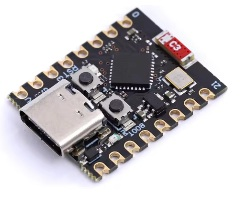
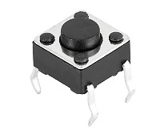
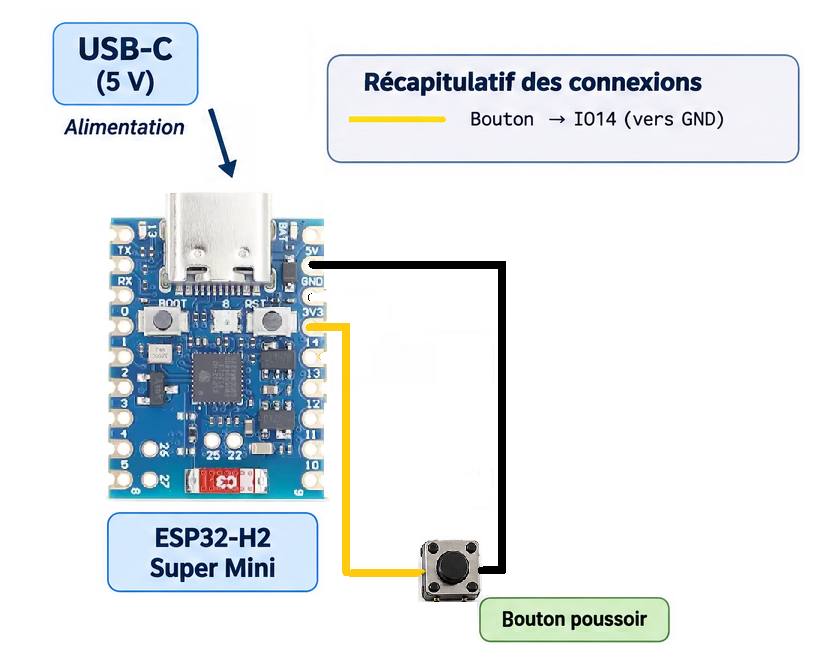
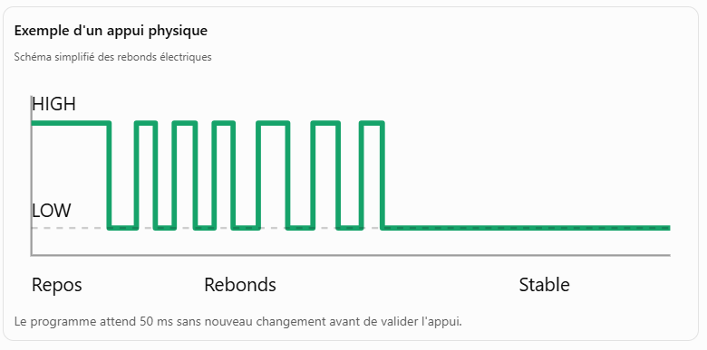

# ESP32-H2 SuperMini Zigbee : état d’un bouton GPIO vers Home Assistant

Ce tutoriel montre comment créer un composant Zigbee avec un **ESP32-H2 SuperMini**. Un bouton externe raccordé à **GPIO14** est surveillé et son état (appuyé ou relâché) est envoyé à chaque changement, via une passerelle/coordinatrice Zigbee utilisant **Zigbee2MQTT**, vers Home Assistant.

> [!IMPORTANT]
> L'ESP32-H2 ne publie pas directement en MQTT. Il communique en **Zigbee** avec la coordinatrice. C'est **Zigbee2MQTT** qui convertit ensuite les messages Zigbee en messages MQTT pour Home Assistant.


# 📺 Vidéo

Lien Youtube: [https://www.youtube.com/@Baronnix](https://www.youtube.com/@Baronnix)

## 1. Architecture

```text
ESP32-H2 SuperMini
   │
   │ Zigbee 3.0 / IEEE 802.15.4
   ▼
Coordinateur Zigbee
   │
   │ Zigbee2MQTT
   ▼
Broker MQTT
   │
   ▼
Home Assistant
```

## 2. Fonctionnement attendu

Le firmware gère deux modes :

1. **Mode appairage**
   - L'ESP32-H2 cherche un réseau Zigbee ouvert.
   - Zigbee2MQTT doit avoir l'option **Appairage autorisé** activée.
   - Une fois appairé, le composant apparaît dans Zigbee2MQTT et Home Assistant.

2. **Mode fonctionnement**
   - Un bouton externe est lu sur GPIO14 avec une résistance de tirage interne.
   - Son état est exposé avec un cluster Zigbee **Binary Input** et envoyé à chaque changement stable (avec anti-rebond).
   - L’état courant est également envoyé une fois après la connexion au réseau Zigbee.
   - Un appui long sur le bouton `BOOT` réinitialise la configuration Zigbee et relance l'appairage.

> Le bouton est câblé entre GPIO14 et GND : `LOW` signifie **appuyé** et `HIGH` signifie **relâché**. Le bouton `BOOT` reste réservé à la réinitialisation Zigbee.

## 3. Matériel nécessaire

- Une carte **ESP32-H2 SuperMini** avec connecteur USB-C et 4 Mo de flash



- Un bouton poussoir externe, raccordé entre GPIO14 et GND



- Un câble USB adapté à la carte
- Home Assistant avec une passerelle Zigbee. Voir tutoriels:
    * [02 - Installation Home Assistant](https://www.youtube.com/watch?v=F-s3jXZxmUI)
    * [04 - Zigbee Installation et Utilisation](https://www.youtube.com/watch?v=F-s3jXZxmUI))
- Accès à l’interface Home Assistant 
- Arduino IDE 2.x avec le core Espressif ESP32 (Voir tutoriel [01 - ESP32 Arduino - USB‑C MIDI Controleur - Premiere Programmation](https://www.youtube.com/watch?v=1if2j6FiMQ4))

## 3.1 Broches utiles et cablage de l’ESP32-H2 SuperMini

| Fonction | Broche | Remarque |
|---|---:|---|
| Bouton BOOT | GPIO9 | Actif à l’état bas, également broche de strapping |
| USB-C natif | USB Serial/JTAG | Utilisé pour le flash et le moniteur série |
| Bouton externe | GPIO14 | Câbler le bouton entre GPIO14 et GND |

> Les cartes SuperMini sont produites par plusieurs fabricants. Vérifier le marquage de votre exemplaire avant le câblage. GPIO9 est réservé au bouton BOOT ; le bouton externe utilise GPIO14.



## 3.2 Dependances et Versions

* Arduino IDE - 2.3.10
* Cartes:
  * esp32 par Espressif Systems - 3.3.12

## 4. Préparation d'Arduino IDE

### 4.1 Installer le support ESP32

Dans **Arduino IDE > Fichier > Préférences**, ajouter l'URL suivante dans **Additional Boards Manager URLs** :

```text
https://espressif.github.io/arduino-esp32/package_esp32_index.json
```

Puis ouvrir **Outils > Carte > Gestionnaire de cartes**, rechercher `esp32` et installer le package **esp32 by Espressif Systems**.

### 4.2 Sélectionner les options Zigbee

Dans le menu **Tools** :

- **Board** : `ESP32H2 Dev Module`
- **USB CDC On Boot** : `Enabled`
- **Upload Mode** : `UART0 / Hardware CDC` si cette option est proposée
- **Zigbee mode** : `Zigbee ED (end device)`
- **Partition Scheme** : `Zigbee 4MB with spiffs`
- **Erase All Flash Before Sketch Upload** : `Enabled` pour le premier flash ou après un problème d'appairage
- **Core Debug Level** : `Info` ou `Verbose` pendant les tests

> Les noms des menus peuvent légèrement varier selon la version du core Arduino ESP32.

## 5. Code Arduino

Créer un nouveau sketch, par exemple `esp32_h2_button_zigbee.ino`, puis copier le code suivant :

```cpp

#include <Arduino.h>
#include "Zigbee.h"

// --------------------------------------------------
// CONFIGURATION
// --------------------------------------------------

#define SENSOR_ENDPOINT 10

#define EXTERNAL_BUTTON_PIN 14
#define FACTORY_RESET_PIN 9

const uint32_t DEBOUNCE_MS = 50;
const uint32_t FACTORY_RESET_HOLD_MS = 5000;

// --------------------------------------------------
// ZIGBEE BINARY INPUT
// --------------------------------------------------

ZigbeeBinary buttonSensor(SENSOR_ENDPOINT);

// --------------------------------------------------
// VARIABLES BOUTON GPIO14
// --------------------------------------------------

bool lastRawButtonState = false;
bool stableButtonState = false;
uint32_t lastDebounceTime = 0;

// --------------------------------------------------
// VARIABLES FACTORY RESET GPIO9
// --------------------------------------------------

uint32_t bootButtonPressTime = 0;
bool factoryResetTriggered = false;

// --------------------------------------------------
// SETUP
// --------------------------------------------------

void setup() {

  Serial.begin(115200);
  delay(2000);

  Serial.println();
  Serial.println("Demarrage ESP32-H2 Zigbee");

  // Initialisation des boutons
  pinMode(EXTERNAL_BUTTON_PIN, INPUT_PULLUP);
  pinMode(FACTORY_RESET_PIN, INPUT_PULLUP);

  // Initialisation de l'etat du bouton GPIO14
  lastRawButtonState = digitalRead(EXTERNAL_BUTTON_PIN) == LOW;
  stableButtonState = lastRawButtonState;

  // Configuration du capteur Zigbee
  buttonSensor.setManufacturerAndModel(
    "DIY",
    "ESP32-H2-GPIO14-Button"
  );

  buttonSensor.addBinaryInput();

  buttonSensor.setBinaryInputApplication(
    BINARY_INPUT_APPLICATION_TYPE_HVAC_OTHER
  );

  buttonSensor.setBinaryInputDescription("Bouton GPIO14");

  buttonSensor.setBinaryInput(stableButtonState);

  // Ajout de l'endpoint
  Zigbee.addEndpoint(&buttonSensor);

  // Configuration Zigbee
  Zigbee.setDebugMode(true);
  Zigbee.setPrimaryChannelMask(1UL << 11);

  // Demarrage Zigbee
  Zigbee.begin();

  Serial.println("Initialisation Zigbee terminee");
}

// --------------------------------------------------
// LOOP
// --------------------------------------------------

void loop() {

  // ================================================
  // 1. BOUTON BOOT GPIO9 : FACTORY RESET
  // ================================================

  bool bootButtonPressed = (digitalRead(FACTORY_RESET_PIN) == LOW);

  if (bootButtonPressed && !factoryResetTriggered) {

    // Premier appui
    if (bootButtonPressTime == 0) {
      bootButtonPressTime = millis();
      Serial.println("Bouton BOOT : appui detecte");
    }

    // Maintien pendant 5 secondes
    if (millis() - bootButtonPressTime >= FACTORY_RESET_HOLD_MS) {

      factoryResetTriggered = true;

      Serial.println();
      Serial.println("FACTORY RESET ZIGBEE !");
      Serial.println("Effacement du reseau et redemarrage...");

      delay(500);

      // Efface les parametres Zigbee et redemarre
      Zigbee.factoryReset(true);

      // Securite si la fonction ne redemarre pas
      while (true) {
        delay(1000);
      }
    }

  } else if (!bootButtonPressed) {

    // Relachement du bouton BOOT
    bootButtonPressTime = 0;
  }

  // ================================================
  // 2. BOUTON EXTERNE GPIO14 : BINARY INPUT
  // ================================================

  bool rawButtonState = digitalRead(EXTERNAL_BUTTON_PIN) == LOW;

  // Detection changement brut
  if (rawButtonState != lastRawButtonState) {

    lastRawButtonState = rawButtonState;
    lastDebounceTime = millis();
  }

  // Anti-rebond
  if (millis() - lastDebounceTime >= DEBOUNCE_MS &&
      rawButtonState != stableButtonState) {

    stableButtonState = rawButtonState;

    // Mise a jour du cluster
    buttonSensor.setBinaryInput(stableButtonState);

    Serial.printf(
      "Bouton GPIO14 : %s\n",
      stableButtonState ? "APPUYE" : "RELACHE"
    );

    // Publication Zigbee
    bool result = buttonSensor.reportBinaryInput();

    Serial.printf(
      "Publication Zigbee : %s\n",
      result ? "OK" : "ECHEC"
    );
  }

  // ================================================
  // 3. SURVEILLANCE CONNEXION ZIGBEE
  // ================================================

  static uint32_t lastLog = 0;

  if (millis() - lastLog >= 2000) {

    lastLog = millis();

    Serial.printf(
      "Zigbee connected : %d\n",
      Zigbee.connected()
    );
  }

  delay(10);
}
```

## 6. Compilation et flash

1. Connecter l'ESP32-H2 SuperMini avec un câble USB-C prenant en charge les données.
2. Sélectionner `ESP32H2 Dev Module`, puis le port série dans **Tools > Port**.
3. Si le port n’apparaît pas, maintenir `BOOT`, appuyer brièvement sur `RST`, relâcher `RST`, puis relâcher `BOOT`.
4. Cliquer sur **Upload**.
5. Ouvrir le **Serial Monitor** à `115200 bauds`.
6. Vérifier que le message suivant apparaît :

```text
Mode appairage : attente de connexion au réseau Zigbee...
```

## 7. Appairage avec Zigbee2MQTT

1. Ouvrir l'interface Zigbee2MQTT.
2. Cliquer sur **Appairage autorisé**.
3. Redémarrer l'ESP32-H2, ou maintenir `BOOT` pendant environ cinq secondes pour effacer l'ancien réseau.
4. Attendre la fin de l'interview Zigbee.
5. Renommer le composant, par exemple `esp32_h2_button`.

Une fois connecté, l'état courant du bouton est envoyé. À chaque appui ou relâchement, le moniteur série doit afficher des lignes similaires à :

```text
Bouton GPIO14 : appuyé
État du bouton envoyé : appuyé
Bouton GPIO14 : relâché
État du bouton envoyé : relâché
```

## 8. Affichage dans Home Assistant

Si votre version de Zigbee2MQTT prend en charge le cluster **Binary Input** et que la découverte MQTT est activée, une entité peut être créée automatiquement dans Home Assistant. Sinon, configurez un external converter Zigbee2MQTT pour exposer l'attribut binaire.

Pour l'ajouter au tableau de bord :

1. Ouvrir **Settings > Devices & services > MQTT**.
2. Rechercher le composant `ESP32-H2-GPIO14-Button`.
3. Vérifier que l'état du bouton change lors d'un appui et d'un relâchement.
4. Ouvrir un tableau de bord.
5. Cliquer sur **Edit dashboard > Add card**.
6. Choisir une carte **Tile** ou **Entities** adaptée à une entité binaire.
7. Sélectionner l'entité créée par Zigbee2MQTT.

Exemple de carte Lovelace :

```yaml
type: tile
entity: binary_sensor.esp32_h2_button
name: Bouton GPIO14
```

Adapter `entity` au nom réellement créé dans Home Assistant. Selon le support du cluster **Binary Input** par la version de Zigbee2MQTT utilisée, l'entité peut ne pas être découverte automatiquement ; voir le dépannage ci-dessous.

## 9. Vérification côté MQTT

Pour vérifier le trajet complet, écouter le topic du composant :

```bash
mosquitto_sub -h ADDRESS_MQTT -u MQTT_USER -P MQTT_PASSWORD \
  -t 'zigbee2mqtt/esp32_h2_button' -v
```

Exemple de message attendu :

```json
{
  "linkquality": 128,
  "presentValue": true
}
```

Le nom et le format de la propriété dépendent de la version de Zigbee2MQTT et du convertisseur associé au cluster **Binary Input**.

## 10. Dépannage

### Le composant ne rejoint pas le réseau

- Vérifier que **Permit join** est actif dans Zigbee2MQTT.
- Rapprocher l'ESP32-H2 de la coordinatrice pour le premier appairage.
- Activer **Erase All Flash Before Sketch Upload**, reflasher, puis recommencer.
- Maintenir `BOOT` pendant environ cinq secondes pour appeler `Zigbee.factoryReset()`.
- Vérifier que **Zigbee mode** est configuré sur `Zigbee ED`.
- Vérifier que le schéma de partition Zigbee est sélectionné.
- Si le téléchargement reste bloqué, utiliser la séquence `BOOT` + `RST` décrite dans la section de flash.
- Utiliser un câble USB-C de données, certains câbles ne fournissent que l’alimentation.

### Le composant est détecté mais marqué comme non pris en charge

Le réseau Zigbee peut reconnaître le composant sans que Zigbee2MQTT possède un convertisseur correspondant à sa signature fabricant/modèle. Dans ce cas :

1. Vérifier si l'attribut `presentValue` du cluster **Binary Input** est tout de même visible dans les informations du composant.
2. Relancer l'interview du composant dans Zigbee2MQTT.
3. Supprimer le composant, effectuer un factory reset, puis l'appairer de nouveau.
4. Si nécessaire, créer un **external converter** Zigbee2MQTT pour le modèle `ESP32-H2-GPIO14-Button`.
5. Vérifier la prise en charge du cluster **Binary Input** par l'intégration Zigbee utilisée avant d'attendre une entité Home Assistant.

### L'état du bouton n'est pas publié

- Vérifier que le moniteur série affiche `Bouton GPIO14` lors d'un changement d'état, puis `État du bouton envoyé`.
- Vérifier que `Zigbee.connected()` reste vrai.
- Regarder les logs Zigbee2MQTT et le topic MQTT du composant.
- Vérifier le câblage entre GPIO14 et GND ; le bouton est actif à l'état bas.
- Si aucune entité n'est créée, vérifier la prise en charge du cluster **Binary Input** par Zigbee2MQTT ou utiliser un external converter adapté.
- Désactiver temporairement les modes d'économie d'énergie pendant le diagnostic.

### Erreur de compilation sur une méthode Zigbee

L'API Zigbee d'Arduino ESP32 évolue. Vérifier que le core **esp32 by Espressif Systems** est à jour. Si les méthodes `ZigbeeBinary` utilisées dans ce tutoriel ne sont pas disponibles, ouvrir l'exemple fourni avec le core :

```text
File > Examples > Zigbee > Zigbee_Binary_Input_Output
```

Puis adapter le tutoriel à la signature des méthodes de cette version.

## 11. Limites et améliorations possibles

- L'état est transporté avec le cluster **Binary Input** ; son exposition dans Home Assistant dépend de la prise en charge de ce cluster par Zigbee2MQTT.
- L'anti-rebond logiciel de 50 ms évite de publier plusieurs changements dus aux rebonds mécaniques du bouton.
- Pour une alimentation sur batterie, ajouter le deep sleep seulement après validation de l'appairage et du reporting.
- Après toute modification importante des endpoints ou clusters, faire un factory reset et réappairer le composant afin de relancer une interview complète.

## 12. Critères de réussite

Le tutoriel est validé lorsque :

- L'ESP32-H2 apparaît dans Zigbee2MQTT.
- L'appairage survit à un redémarrage de la carte.
- L'état appuyé/relâché du bouton GPIO14 est envoyé à chaque changement.
- L'état est visible dans les logs Zigbee2MQTT.
- L'état est publié sur un topic MQTT et visible dans Home Assistant (si le cluster est pris en charge).
- Une entité correspondante est visible dans Home Assistant.
- Un appui long sur `BOOT` efface le réseau Zigbee et permet un nouvel appairage.

# Explications de code

## 1. Les bibliothèques et les paramètres

### 1.1 Les bibliothèques

```cpp
#include <Arduino.h>
#include "Zigbee.h"
```

* `Arduino.h` donne accès aux fonctions Arduino : `pinMode()`, `digitalRead()`, `millis()`, `delay()`, etc.
* `Zigbee.h` donne accès à la bibliothèque Zigbee intégrée à Arduino-ESP32.

La bibliothèque Zigbee permet à l'ESP32-H2 de communiquer avec un réseau Zigbee et de créer des endpoints et des clusters.

### 1.2 Définition des broches

```cpp
#define SENSOR_ENDPOINT 10

#define EXTERNAL_BUTTON_PIN 14
#define FACTORY_RESET_PIN 9
```

Ces constantes définissent les éléments matériels et logiques du projet.

| Constante | Valeur | Rôle |
| --------- | ------ | ---- |
| `SENSOR_ENDPOINT` | 10 | Identifiant de l'endpoint Zigbee |
| `EXTERNAL_BUTTON_PIN` | 14 | Bouton externe |
| `FACTORY_RESET_PIN` | 9 | Bouton BOOT | 

Un endpoint Zigbee est un point de terminaison logique d'un appareil. Il peut exposer un ou plusieurs clusters.

Ici, l'endpoint 10 héberge notre capteur binaire.

### 1.3 Les temporisations

```cpp
const uint32_t DEBOUNCE_MS = 50;
const uint32_t FACTORY_RESET_HOLD_MS = 5000;
```

*`DEBOUNCE_MS` : attend 50 millisecondes avant de considérer qu'un changement d'état est réel.
*`FACTORY_RESET_HOLD_MS` : demande de maintenir BOOT pendant 5 000 millisecondes, soit 5 secondes.
*`uint32_t` est un entier non signé de 32 bits. Il est adapté pour stocker des durées en millisecondes.


## 2. Création du capteur Zigbee

```cpp
ZigbeeBinary buttonSensor(SENSOR_ENDPOINT);
```

Cette ligne crée un objet nommé `buttonSensor` de type `ZigbeeBinary`.

Cet objet représente ton capteur binaire dans le réseau Zigbee.

Il permet notamment :
* de définir les caractéristiques du capteur ;
* de déclarer son cluster ;
* de modifier son état ;
* de publier les changements.

L'objet est créé en dehors de `setup()` pour rester accessible partout dans le programme.

### 2.1 Les variables du bouton GPIO14

```cpp
bool lastRawButtonState = false;
bool stableButtonState = false;
uint32_t lastDebounceTime = 0;
```

Ces variables servent à gérer les rebonds mécaniques du bouton.

| Variable | Utilité |
| --- | --- |
| `lastRawButtonState` | Dernier état électrique lu |
| `stableButtonState` | Dernier état validé |
| `lastDebounceTime` | Moment du dernier changement électrique |

Lorsqu'on appuie sur un bouton mécanique, le contact peut osciller très rapidement avant de se stabiliser.



Le programme attend donc 50 ms sans nouveau changement avant de valider l'appui.

### 2.2 Les variables du Factory Reset

```cpp
uint32_t bootButtonPressTime = 0;
bool factoryResetTriggered = false;
```

* `bootButtonPressTime` mémorise le moment où le bouton BOOT a été pressé.
* `factoryResetTriggered` indique si la réinitialisation a déjà été déclenchée.

Ces variables permettent de détecter un appui long de 5 secondes et d'éviter plusieurs déclenchements.

## 3. La fonction `setup()` : démarrage de l'ESP32

`setup()` est exécutée une seule fois au démarrage ou après un redémarrage de la carte.

### 3.1 Initialisation du port série

```cpp
Serial.begin(115200);
delay(2000);

Serial.println();
Serial.println("Demarrage ESP32-H2 Zigbee");
```

* `Serial.begin(115200)` démarre la communication série à 115 200 bauds.
* `delay(2000)` attend 2 secondes pour laisser le temps au moniteur série USB de s'initialiser.
* `Serial.println()` affiche un message dans le moniteur série.

Cette partie sert au diagnostic. Elle n'est pas indispensable au fonctionnement Zigbee.

### 3.2 Configuration des broches

```cpp
pinMode(EXTERNAL_BUTTON_PIN, INPUT_PULLUP);
pinMode(FACTORY_RESET_PIN, INPUT_PULLUP);
```
On configure les deux broches en entrée avec une résistance de rappel interne vers le niveau haut (`INPUT_PULLUP`).

Cela signifie :
| État du bouton | Valeur lue |
| --- | --- | 
| Relâché | HIGH (1) |
| Appuyé | LOW (0) |

Le bouton doit relier la broche GPIO à GND lorsqu'on appuie dessus.

### 3.3 Initialisation de l'état du bouton

```cpp
lastRawButtonState = digitalRead(EXTERNAL_BUTTON_PIN) == LOW;
stableButtonState = lastRawButtonState;
```

Au démarrage, on lit directement l'état du bouton GPIO14.

On initialise les deux variables avec cette valeur.

Cela permet notamment de connaître immédiatement l'état du bouton si l'ESP32 redémarre alors qu'il est déjà maintenu.

### 3.4 Identification de l'appareil Zigbee

```cpp
buttonSensor.setManufacturerAndModel(
  "DIY",
  "ESP32-H2-GPIO14-Button"
);
```

Cette instruction définit deux informations :
* Fabricant : `DIY`
* Modèle : `ESP32-H2-GPIO14-Button`

Ces informations permettent d'identifier ton appareil dans Zigbee2MQTT.

### 3.5 Déclaration du cluster Binary Input

```cpp
buttonSensor.addBinaryInput();
```

Cette instruction ajoute le cluster Zigbee Binary Input à l'endpoint 10.

Ce cluster représente une entrée binaire, donc une information qui possède deux états.

```cpp
buttonSensor.setBinaryInputApplication(
  BINARY_INPUT_APPLICATION_TYPE_HVAC_OTHER
);
```

Cette ligne définit le type d'application associé à l'entrée.

Ici, `HVAC_OTHER` correspond à une catégorie générique liée aux équipements HVAC (chauffage, ventilation et climatisation).

Ce choix décrit le type d'application déclaré dans le cluster.

```cpp
buttonSensor.setBinaryInputDescription("Bouton GPIO14");
```

Cette instruction ajoute une description lisible de l'entrée.

Enfin :
```cpp
buttonSensor.setBinaryInput(stableButtonState);
```

On initialise la valeur du cluster avec l'état réel du bouton au démarrage.

Cela évite de publier une valeur initiale qui ne correspondrait pas à la réalité physique.

### 3.6 Ajout de l'endpoint et démarrage Zigbee

```cpp
Zigbee.addEndpoint(&buttonSensor);
```

On enregistre notre capteur auprès de la pile Zigbee.

Le `&` signifie qu'on transmet l'adresse de l'objet, et non une copie de celui-ci.

Puis :

```cpp
Zigbee.setDebugMode(true);
Zigbee.setPrimaryChannelMask(1UL << 11);
Zigbee.begin();
```

Détaillons ces trois instructions :
* `setDebugMode(true)` active les traces de diagnostic Zigbee.
* `setPrimaryChannelMask(1UL << 11)` sélectionne le canal Zigbee 11.
* `Zigbee.begin()` démarre la pile Zigbee et lance le processus de connexion au réseau.

Le `1UL << 11` est un décalage binaire : il positionne le bit numéro 11 dans le masque des canaux.

À ce stade, Zigbee2MQTT peut découvrir l'appareil, l'interviewer et identifier son endpoint 10 avec le cluster Binary Input.

## 4. La fonction `loop()` : fonctionnement permanent

Contrairement à `setup()`, la fonction `loop()` est exécutée en permanence.

C'est ici que se trouve toute la logique de surveillance des boutons.

### 4.1 Gestion du bouton BOOT (GPIO9)

```cpp
bool bootButtonPressed =
  (digitalRead(FACTORY_RESET_PIN) == LOW);
```

On lit le bouton BOOT.
* Si la lecture est `LOW`, le bouton est appuyé.
* Si la lecture est `HIGH`, le bouton est relâché.

Ensuite :
```cpp
if (bootButtonPressed && !factoryResetTriggered) {
```

On vérifie deux conditions :
* Le bouton est appuyé.
* Le reset n'a pas déjà été déclenché.

Cela évite de déclencher plusieurs réinitialisations pendant un même appui.

Mémorisation du début de l'appui
```cpp
if (bootButtonPressTime == 0) {
  bootButtonPressTime = millis();
  Serial.println("Bouton BOOT : appui detecte");
}
```

`millis()` renvoie le nombre de millisecondes écoulées depuis le démarrage de l'ESP32.

On mémorise donc le moment où le bouton a été pressé.

Calcul du temps de maintien
```cpp
if (millis() - bootButtonPressTime >= FACTORY_RESET_HOLD_MS) {
```

On calcule la durée de l'appui :
* `Durée = millis() - début de l'appui`

Si cette durée atteint 5 000 ms, le programme déclenche le reset.

Pourquoi utiliser `millis()` plutôt que `delay(5000)` ?

Parce que `delay(5000)` bloquerait complètement le programme pendant cinq secondes. Avec `millis()`, on peut continuer à surveiller les autres fonctions pendant ce temps.

Déclenchement du Factory Reset
```cpp
factoryResetTriggered = true;

Serial.println("FACTORY RESET ZIGBEE !");

delay(500);

Zigbee.factoryReset(true);
```

La variable `factoryResetTriggered` empêche une seconde exécution.

La fonction :
```cpp
Zigbee.factoryReset(true);
```
demande à la bibliothèque Zigbee d'effacer les paramètres réseau et de redémarrer l'appareil.

L'ESP32 perd son association au réseau Zigbee et devra être réappairé.

Enfin :
```cpp
while (true) {
  delay(1000);
}
```

Cette boucle infinie sert de sécurité : si la fonction de réinitialisation ne redémarre pas immédiatement la carte, le programme ne poursuit pas son fonctionnement normal.

### 4.2 Détection du bouton GPIO14

```cpp
bool rawButtonState =
  digitalRead(EXTERNAL_BUTTON_PIN) == LOW;
```

On lit l'état électrique du bouton.

La variable `rawButtonState` vaut :
* `true` lorsque le bouton est appuyé ;
* `false` lorsqu'il est relâché.

Détection d'un changement
```cpp
if (rawButtonState != lastRawButtonState) {

  lastRawButtonState = rawButtonState;
  lastDebounceTime = millis();
}
```

On compare la nouvelle lecture avec la lecture précédente.

Si elles sont différentes, cela signifie qu'un changement vient de se produire.

On mémorise alors :
* le nouvel état brut ;
* l'instant du changement.

Validation après 50 ms
```cpp
if (millis() - lastDebounceTime >= DEBOUNCE_MS &&
    rawButtonState != stableButtonState) {
```

Cette condition vérifie deux choses :
* Au moins 50 ms se sont écoulées depuis le dernier changement électrique.
* Le nouvel état est différent de l'état déjà validé.

Si les deux conditions sont réunies, le changement est considéré comme réel.

On met alors à jour l'état stable :
```cpp
stableButtonState = rawButtonState;
```

### 4.3 Mise à jour du cluster Zigbee

```cpp
buttonSensor.setBinaryInput(stableButtonState);
```

Cette instruction met à jour la valeur du cluster Binary Input.

| Action physique |	Valeur |
| --| -- |
| Appui |	`true` |
| Relâchement |	`false` |

Il faut distinguer deux opérations :
* `setBinaryInput()` : met à jour la valeur du cluster dans le logiciel.
* `reportBinaryInput()` : demande la publication de cette valeur sur le réseau Zigbee.

### 4.4 Publication sur Zigbee

```cpp
bool result = buttonSensor.reportBinaryInput();
```

On demande à la bibliothèque Zigbee de publier l'état du capteur.

Le résultat est ensuite affiché :
```cpp
Serial.printf(
  "Publication Zigbee : %s\n",
  result ? "OK" : "ECHEC"
);
```

L'opérateur conditionnel `? :` signifie :
* si `result` est vrai, on affiche `OK` ;
* sinon, on affiche `ECHEC`.

Un retour `OK` indique que la fonction a accepté la demande de publication. Cela ne constitue pas à lui seul une confirmation de réception par Zigbee2MQTT.

## 5. Surveillance de la connexion Zigbee

```cpp
static uint32_t lastLog = 0;

if (millis() - lastLog >= 2000) {

  lastLog = millis();

  Serial.printf(
    "Zigbee connected : %d\n",
    Zigbee.connected()
  );
}
```

Cette partie affiche l'état de connexion Zigbee toutes les deux secondes.

La fonction :
```cpp
Zigbee.connected()
```

permet de savoir si l'appareil est connecté au réseau Zigbee.

Elle renvoie :
* `1` : connecté ;
* `0` : non connecté.

Pourquoi `static` devant `lastLog` ?

Une variable locale classique est recréée à chaque exécution de la fonction. Une variable `static` conserve sa valeur entre deux passages dans `loop()`.

C'est indispensable ici pour mémoriser l'heure du dernier affichage.

Enfin :
```cpp
delay(10);
```

Le programme attend 10 ms avant de recommencer la boucle.

Cela évite de faire tourner inutilement le processeur à pleine vitesse.

## 6. Résumé du fonctionnement complet

Démarrage
1. Initialisation du port série et des GPIO.
2. Création du capteur Zigbee Binary Input.
3. Configuration de l'endpoint 10.
4. Démarrage de Zigbee et connexion au réseau.

Fonctionnement normal
1. L'ESP32 surveille GPIO14.
2. Il détecte un changement électrique.
3. Il attend 50 ms pour éliminer les rebonds.
4. Il met à jour le cluster Binary Input.
5. Il publie le changement sur Zigbee.

Réinitialisation
1. L'ESP32 surveille GPIO9.
2. Il détecte un appui prolongé.
3. Après 5 secondes, il déclenche le Factory Reset.

L'appareil redémarre et doit être réappairé.