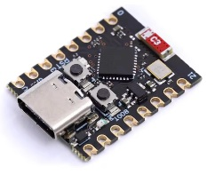
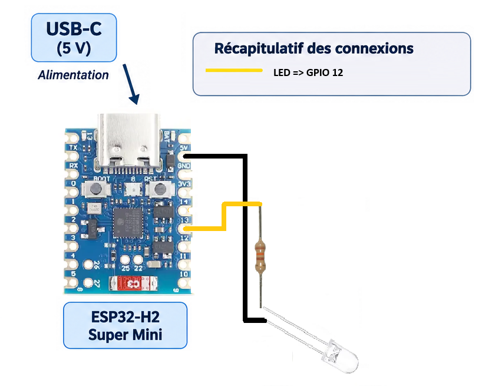

# ESP32-H2 SuperMini Zigbee : commande d’une LED depuis Home Assistant

Ce tutoriel montre comment créer un appareil Zigbee avec un **ESP32-H2 SuperMini**. L’ESP32-H2 reçoit une commande **allumé / éteint** depuis Home Assistant, via une coordinatrice Zigbee et **Zigbee2MQTT**, puis applique cet état sur une LED raccordée à un GPIO.

Contrairement au tutoriel précédent, l’ESP32-H2 n’envoie plus l’état d’un bouton vers Home Assistant : il reçoit une commande Zigbee et pilote une sortie.

> [!IMPORTANT]
> L’ESP32-H2 ne communique pas directement en MQTT. Il communique en **Zigbee** avec la coordinatrice. **Zigbee2MQTT** fait le lien entre le réseau Zigbee et MQTT, puis Home Assistant commande l’entité lumière.

# 📺 Vidéo

Lien YouTube : [https://www.youtube.com/@Baronnix](https://www.youtube.com/@Baronnix)

## 1. Architecture

```text
Home Assistant
      │
      │ MQTT
      ▼
Zigbee2MQTT
      │
      │ Zigbee 3.0 / IEEE 802.15.4
      ▼
Coordinateur Zigbee
      │
      ▼
ESP32-H2 SuperMini
      │
      │ GPIO12
      ▼
LED / diode
```

Home Assistant commande une entité de type **lumière**. Zigbee2MQTT transmet la commande On/Off sur le réseau Zigbee. L’ESP32-H2 reçoit cette commande dans son endpoint lumière et modifie le niveau logique de GPIO2.

## 2. Fonctionnement attendu

Le firmware expose un appareil Zigbee de type **On/Off Light**.

1. **Mode appairage**
   - L’ESP32-H2 cherche à rejoindre un réseau Zigbee.
   - Dans Zigbee2MQTT, l’option **Appairage autorisé** doit être activée.
   - Après l’interview, l’appareil doit être reconnu comme une lumière On/Off, si la version de Zigbee2MQTT dispose du convertisseur correspondant.

2. **Mode fonctionnement**
   - Home Assistant envoie une commande `ON` ou `OFF` à l’entité lumière.
   - Zigbee2MQTT transmet la commande à l’ESP32-H2.
   - Le callback `onLightChange()` est appelé avec le nouvel état.
   - Le programme applique cet état sur GPIO12.
   - La LED s’allume ou s’éteint.

3. **Réinitialisation**
   - Un appui long de cinq secondes sur le bouton `BOOT` efface la configuration Zigbee et redémarre la carte.
   - Il faut ensuite autoriser l’appairage dans Zigbee2MQTT et réappairer l’appareil.

> Le GPIO12 est utilisé ici comme sortie pour une LED externe. Le bouton `BOOT` (GPIO9) reste réservé au Factory Reset.

## 3. Matériel nécessaire

- Une carte **ESP32-H2 SuperMini** avec connecteur USB-C et mémoire flash adaptée.



- Une LED / diode électroluminescente.
- Une résistance de limitation de courant, typiquement **220 à 330 Ω**.
- Une plaque d’essai et des fils de connexion.
- Un câble USB-C prenant en charge les données.
- Home Assistant avec une coordinatrice Zigbee et Zigbee2MQTT.
- Arduino IDE 2.x avec le core Espressif ESP32.

Tutoriels utiles :
- [02 - Installation Home Assistant](https://www.youtube.com/watch?v=F-s3jXZxmUI)
- [04 - Zigbee Installation et Utilisation](https://www.youtube.com/watch?v=F-s3jXZxmUI)
- [01 - ESP32 Arduino - USB-C MIDI Controleur - Premiere Programmation](https://www.youtube.com/watch?v=1if2j6FiMQ4)

### 3.1 Broches utiles et câblage de l’ESP32-H2 SuperMini

| Fonction | Broche | Remarque |
|---|---:|---|
| Bouton BOOT | GPIO9 | Actif à l’état bas, utilisé pour le Factory Reset |
| LED externe | GPIO12 | Sortie commandée par Home Assistant |
| USB-C natif | USB Serial/JTAG | Programmation et moniteur série |

Câblage proposé pour une LED externe :



L’anode (positif) est généralement la patte la plus longue. La cathode (négatif) est généralement la patte la plus courte et correspond au côté plat du boîtier.

Avec ce câblage, `HIGH` allume la LED et `LOW` l’éteint. Ne raccordez pas une LED directement au GPIO sans résistance.

> Les cartes ESP32-H2 SuperMini existent en plusieurs variantes. Vérifiez le marquage de votre carte et la disponibilité de GPIO12 avant le câblage. N’alimentez pas directement une lampe ou une charge de puissance depuis un GPIO : utilisez un transistor, un MOSFET ou un module de commande adapté.

## 4. Préparation d’Arduino IDE

### 4.1 Installer le support ESP32

Dans **Arduino IDE > File > Preferences**, ajouter cette URL dans **Additional Boards Manager URLs** :

```text
https://espressif.github.io/arduino-esp32/package_esp32_index.json
```

Puis ouvrir **Tools > Board > Boards Manager**, rechercher `esp32` et installer **esp32 by Espressif Systems**.

### 4.2 Sélectionner les options Zigbee

Dans le menu **Tools** :

- **Board** : `ESP32H2 Dev Module`
- **USB CDC On Boot** : `Enabled`
- **Upload Mode** : `UART0 / Hardware CDC` si cette option est proposée
- **Zigbee mode** : `Zigbee ED (end device)`
- **Partition Scheme** : `Zigbee 4MB with spiffs`
- **Erase All Flash Before Sketch Upload** : `Enabled` lors du premier flash ou après un problème d’appairage
- **Core Debug Level** : `Info` ou `Verbose` pendant les tests

Les intitulés peuvent varier légèrement selon la version du core Arduino ESP32.

### 4.3 Dépendances et versions

Le code utilise la bibliothèque Zigbee intégrée au core Arduino-ESP32. Il n’est pas nécessaire d’installer une bibliothèque Zigbee tierce.

Versions de référence reprises du tutoriel précédent :
- Arduino IDE : 2.3.10
- `esp32` par Espressif Systems : 3.3.12

L’API utilisée ici est `ZigbeeLight`, avec `onLightChange()`, `setLight()` et `getLightState()`.

## 5. Code Arduino

Créer un nouveau sketch nommé `esp32_h2_zigbee_light.ino`, puis copier le code ci-dessous. Le fichier `.ino` est également fourni avec ce README.

```cpp
#include <Arduino.h>
#include "Zigbee.h"

// Vérifie que le mode Zigbee End Device est sélectionné.
#ifndef ZIGBEE_MODE_ED
#error "Sélectionner Tools > Zigbee mode > Zigbee ED (end device)"
#endif

// --------------------------------------------------
// CONFIGURATION
// --------------------------------------------------

#define LIGHT_ENDPOINT       10
#define LED_PIN              12
#define FACTORY_RESET_PIN    9

const uint32_t FACTORY_RESET_HOLD_MS = 5000;

// Avec le câblage proposé : HIGH = LED allumée.
const bool LED_ACTIVE_HIGH = true;

// --------------------------------------------------
// ZIGBEE ON/OFF LIGHT
// --------------------------------------------------

ZigbeeLight zbLight(LIGHT_ENDPOINT);

// --------------------------------------------------
// VARIABLES FACTORY RESET
// --------------------------------------------------

uint32_t bootButtonPressTime = 0;
bool factoryResetTriggered = false;

// --------------------------------------------------
// CALLBACK : COMMANDE ON/OFF REÇUE
// --------------------------------------------------

void applyLedState(bool state) {
  const uint8_t outputLevel =
    (state == LED_ACTIVE_HIGH) ? HIGH : LOW;

  digitalWrite(LED_PIN, outputLevel);

  Serial.printf(
    "Commande Zigbee reçue : lumière %s -> GPIO%d = %s\n",
    state ? "ALLUMÉE" : "ÉTEINTE",
    LED_PIN,
    outputLevel == HIGH ? "HIGH" : "LOW"
  );
}

// --------------------------------------------------
// SETUP
// --------------------------------------------------

void setup() {
  Serial.begin(115200);
  delay(1500);

  Serial.println();
  Serial.println("Démarrage ESP32-H2 - Zigbee On/Off Light");

  // Initialisation de la sortie, LED éteinte.
  pinMode(LED_PIN, OUTPUT);
  digitalWrite(LED_PIN, LED_ACTIVE_HIGH ? LOW : HIGH);

  // Bouton BOOT pour le Factory Reset.
  pinMode(FACTORY_RESET_PIN, INPUT_PULLUP);

  // Identification dans Zigbee2MQTT.
  zbLight.setManufacturerAndModel(
    "DIY",
    "ESP32-H2-GPIO12-Light"
  );

  // Le callback est appelé lors d'un changement d'état.
  zbLight.onLightChange(applyLedState);

  // Ajout de l'endpoint lumière à la pile Zigbee.
  Zigbee.addEndpoint(&zbLight);

  // Configuration Zigbee.
  Zigbee.setDebugMode(true);
  Zigbee.setPrimaryChannelMask(1UL << 11);

  // Démarrage de Zigbee.
  if (!Zigbee.begin()) {
    Serial.println("Échec du démarrage Zigbee. Redémarrage...");
    delay(1000);
    ESP.restart();
  }

  Serial.println("Pile Zigbee démarrée.");
  Serial.println("En attente de connexion au réseau Zigbee...");
}

// --------------------------------------------------
// LOOP
// --------------------------------------------------

void loop() {
  // ================================================
  // 1. BOUTON BOOT GPIO9 : FACTORY RESET
  // ================================================

  const bool bootButtonPressed =
    (digitalRead(FACTORY_RESET_PIN) == LOW);

  if (bootButtonPressed && !factoryResetTriggered) {
    if (bootButtonPressTime == 0) {
      bootButtonPressTime = millis();
      Serial.println("Bouton BOOT : appui détecté");
    }

    if (millis() - bootButtonPressTime >= FACTORY_RESET_HOLD_MS) {
      factoryResetTriggered = true;

      Serial.println();
      Serial.println("FACTORY RESET ZIGBEE !");
      Serial.println("Effacement du réseau et redémarrage...");

      delay(500);
      Zigbee.factoryReset(true);

      while (true) {
        delay(1000);
      }
    }
  } else if (!bootButtonPressed) {
    bootButtonPressTime = 0;
  }

  // ================================================
  // 2. SURVEILLANCE DE LA CONNEXION ET DE L'ÉTAT
  // ================================================

  static uint32_t lastLog = 0;

  if (millis() - lastLog >= 5000) {
    lastLog = millis();

    Serial.printf(
      "Zigbee connecté : %s | État lumière : %s\n",
      Zigbee.connected() ? "OUI" : "NON",
      zbLight.getLightState() ? "ON" : "OFF"
    );
  }

  delay(10);
}
```

### Principe du code

- `ZigbeeLight zbLight(10)` crée un endpoint Zigbee de type lumière On/Off.
- `onLightChange(applyLedState)` enregistre la fonction appelée lorsque la commande d’allumage ou d’extinction est reçue.
- `applyLedState(bool state)` convertit l’état Zigbee en niveau électrique sur GPIO12.
- `Zigbee.begin()` démarre la pile Zigbee.
- `Zigbee.connected()` permet de surveiller la connexion au réseau.
- Un appui de cinq secondes sur BOOT déclenche le Factory Reset.

**Important :** le callback reçoit l’état de la lumière. Il n’est pas nécessaire de lire périodiquement un topic MQTT ou de faire du polling dans Home Assistant.

## 6. Compilation et flash

1. Connecter l’ESP32-H2 SuperMini avec un câble USB-C de données.
2. Sélectionner `ESP32H2 Dev Module`.
3. Sélectionner le port série dans **Tools > Port**.
4. Si le port n’apparaît pas, maintenir `BOOT`, appuyer brièvement sur `RST`, relâcher `RST`, puis relâcher `BOOT`.
5. Cliquer sur **Upload**.
6. Ouvrir le **Serial Monitor** à `115200 bauds`.

Le moniteur série doit afficher des messages similaires à :

```text
Démarrage ESP32-H2 - Zigbee On/Off Light
Pile Zigbee démarrée.
En attente de connexion au réseau Zigbee...
Zigbee connecté : OUI | État lumière : OFF
```

## 7. Appairage avec Zigbee2MQTT

1. Ouvrir l’interface Zigbee2MQTT.
2. Activer **Appairage autorisé** (*Permit join*).
3. Redémarrer l’ESP32-H2.
4. Si la carte était déjà associée à un autre réseau, maintenir `BOOT` pendant environ cinq secondes pour effectuer un Factory Reset.
5. Attendre la découverte et la fin de l’interview Zigbee.
6. Renommer l’appareil, par exemple `esp32_h2_zigbee_light`.

Le firmware déclare un endpoint lumière standard avec le cluster **On/Off**. La création automatique d’une entité lumière dépend toutefois de la prise en charge de la signature de l’appareil par la version de Zigbee2MQTT utilisée.

Si Zigbee2MQTT reconnaît l’appareil comme une lumière, une commande `ON` ou `OFF` doit déclencher le callback et modifier GPIO12.

## 8. Commande depuis Home Assistant

Lorsque Zigbee2MQTT expose l’appareil comme une lumière et que la découverte MQTT Home Assistant est activée :

1. Ouvrir **Paramètres > Appareils et services**.
2. Ouvrir l’intégration MQTT ou Zigbee2MQTT selon votre configuration.
3. Rechercher `ESP32-H2-GPIO12-Light`.
4. Vérifier qu’une entité de type `light` est disponible.
5. Ajouter cette entité à un tableau de bord avec une carte **Tile** ou **Light**.

Exemple de carte Lovelace :

```yaml
type: tile
entity: light.esp32_h2_zigbee_light
name: LED ESP32-H2
```

Remplacer `light.esp32_h2_zigbee_light` par l’identifiant réellement créé dans Home Assistant.

Depuis une automatisation Home Assistant, il est également possible d’appeler :

```yaml
action: light.turn_on
target:
  entity_id: light.esp32_h2_zigbee_light
```

Et pour éteindre la LED :

```yaml
action: light.turn_off
target:
  entity_id: light.esp32_h2_zigbee_light
```

## 9. Vérification du fonctionnement

Le test le plus simple consiste à utiliser le bouton marche/arrêt de l’entité lumière dans Home Assistant.

| Action dans Home Assistant | Commande Zigbee | GPIO12 | LED |
|---|---|---|---|
| Allumer | `ON` | `HIGH` | Allumée |
| Éteindre | `OFF` | `LOW` | Éteinte |

Le moniteur série doit afficher par exemple :

```text
Commande Zigbee reçue : lumière ALLUMÉE -> GPIO12 = HIGH
Commande Zigbee reçue : lumière ÉTEINTE -> GPIO12 = LOW
```

On peut également vérifier l’état de l’appareil dans Zigbee2MQTT et consulter ses journaux.

## 10. Dépannage

### L’ESP32-H2 ne rejoint pas le réseau

- Vérifier que **Permit join** est actif dans Zigbee2MQTT.
- Rapprocher la carte de la coordinatrice pour le premier appairage.
- Vérifier que **Zigbee mode** est réglé sur `Zigbee ED`.
- Vérifier que le schéma de partition Zigbee est sélectionné.
- Essayer **Erase All Flash Before Sketch Upload**, puis reflasher.
- Maintenir BOOT pendant cinq secondes pour demander un Factory Reset.
- Vérifier le câble USB-C et le port série.

### L’appareil est détecté, mais aucune entité lumière n’apparaît

Le firmware déclare bien un endpoint `ZigbeeLight` et le cluster On/Off standard. Cependant, Zigbee2MQTT doit disposer d’un convertisseur capable d’exposer cet appareil comme une lumière.

- Vérifier les journaux de Zigbee2MQTT pendant l’interview.
- Vérifier si le cluster `genOnOff` (On/Off) est visible sur l’endpoint 10.
- Relancer l’interview de l’appareil.
- Vérifier la compatibilité de la version de Zigbee2MQTT.
- Si nécessaire, créer ou adapter un **external converter** Zigbee2MQTT pour le modèle `ESP32-H2-GPIO12-Light`.

La présence de l’appareil dans le réseau Zigbee ne garantit pas, à elle seule, qu’une entité Home Assistant soit créée automatiquement.

### L’entité change d’état, mais la LED ne s’allume pas

- Vérifier que la LED est raccordée à GPIO12 et à GND avec une résistance en série.
- Vérifier le sens de la LED : anode vers la résistance/GPIO, cathode vers GND.
- Vérifier que la broche utilisée est bien GPIO12 sur votre variante de carte.
- Vérifier les messages `Commande Zigbee reçue` dans le moniteur série.
- Si la LED est active à l’état bas, régler `LED_ACTIVE_HIGH` sur `false`.

### La LED fonctionne à l’envers

Le code suppose qu’un niveau `HIGH` allume la LED. Pour un montage actif à l’état bas, modifier :

```cpp
const bool LED_ACTIVE_HIGH = false;
```

### Erreur de compilation sur `ZigbeeLight`

Vérifier que le core **esp32 by Espressif Systems** est installé et à jour, et que la carte sélectionnée est bien `ESP32H2 Dev Module`.

L’API Zigbee évolue avec les versions du core. Consulter la documentation et les exemples Zigbee fournis avec la version installée, notamment l’exemple **Zigbee On/Off Light**.

## 11. Limites et améliorations possibles

- Cette version commande uniquement deux états : allumé et éteint.
- La sortie GPIO12 est destinée à une LED ou à une entrée de commande électronique, pas à alimenter directement une charge de puissance.
- Une LED intégrée peut être utilisée à la place de la LED externe, à condition de vérifier sa broche et sa polarité sur la variante de carte utilisée.
- Il est possible de piloter un relais, un MOSFET ou un autre circuit adapté en remplaçant la LED par l’interface électronique correspondante.
- Une version avec plusieurs sorties pourrait exposer plusieurs endpoints Zigbee ou plusieurs fonctions de commande.
- La découverte automatique dans Home Assistant dépend du convertisseur Zigbee2MQTT utilisé.

## 12. Critères de réussite

Le tutoriel est validé lorsque :

- L’ESP32-H2 rejoint le réseau Zigbee.
- L’appareil est reconnu comme une lumière On/Off dans Zigbee2MQTT, ou est exposé par un convertisseur adapté.
- Une entité lumière est disponible dans Home Assistant.
- Une commande **Allumer** depuis Home Assistant allume la LED raccordée à GPIO12.
- Une commande **Éteindre** depuis Home Assistant éteint la LED.
- Les changements sont visibles dans le moniteur série.
- Un appui long sur `BOOT` efface le réseau Zigbee et permet un nouvel appairage.

# Explications de code

## 1. Les bibliothèques et les paramètres

### 1.1 Les bibliothèques

```cpp
#include <Arduino.h>
#include "Zigbee.h"
```

- `Arduino.h` donne accès aux fonctions Arduino : `pinMode()`, `digitalWrite()`, `millis()`, `delay()`, etc.
- `Zigbee.h` donne accès à la bibliothèque Zigbee intégrée au core Arduino-ESP32.

### 1.2 Définition des broches et de l’endpoint

```cpp
#define LIGHT_ENDPOINT       10
#define LED_PIN              12
#define FACTORY_RESET_PIN    9
```

| Constante | Valeur | Rôle |
|---|---:|---|
| `LIGHT_ENDPOINT` | 10 | Identifiant de l’endpoint Zigbee |
| `LED_PIN` | 12 | Sortie physique qui pilote la LED |
| `FACTORY_RESET_PIN` | 9 | Bouton BOOT |

Un endpoint Zigbee est un point de terminaison logique d’un appareil. Il héberge ici le cluster On/Off qui permet de commander la lumière.

### 1.3 Polarité de la LED

```cpp
const bool LED_ACTIVE_HIGH = true;
```

Cette constante indique comment la LED est pilotée :

- `true` : `HIGH` allume la LED et `LOW` l’éteint.
- `false` : `LOW` allume la LED et `HIGH` l’éteint.

## 2. Création de l’appareil Zigbee

```cpp
ZigbeeLight zbLight(LIGHT_ENDPOINT);
```

Cette instruction crée un objet `ZigbeeLight`. Il représente une lumière On/Off sur le réseau Zigbee.

À la différence du tutoriel précédent, qui utilisait `ZigbeeBinary` pour exposer une entrée binaire, on utilise ici `ZigbeeLight` pour recevoir des commandes d’allumage et d’extinction.

## 3. Le callback de changement d’état

```cpp
void applyLedState(bool state) {
  const uint8_t outputLevel =
    (state == LED_ACTIVE_HIGH) ? HIGH : LOW;

  digitalWrite(LED_PIN, outputLevel);
}
```

Cette fonction est appelée lorsque l’état de la lumière change à la suite d’une commande Zigbee.

- `state == true` signifie que la lumière doit être allumée.
- `state == false` signifie qu’elle doit être éteinte.
- `digitalWrite()` applique le niveau électrique correspondant sur GPIO2.

Le callback fait le lien entre la commande logique Zigbee et la sortie physique de l’ESP32-H2.

## 4. La fonction `setup()` : démarrage de l’ESP32

### 4.1 Initialisation de la sortie

```cpp
pinMode(LED_PIN, OUTPUT);
digitalWrite(LED_PIN, LED_ACTIVE_HIGH ? LOW : HIGH);
```

GPIO12 est configuré en sortie. La LED est placée dans l’état éteint au démarrage.

### 4.2 Configuration du bouton BOOT

```cpp
pinMode(FACTORY_RESET_PIN, INPUT_PULLUP);
```

Le bouton BOOT est configuré en entrée avec résistance de rappel interne. Il est actif à l’état bas :

| État du bouton | Valeur lue |
|---|---|
| Relâché | `HIGH` |
| Appuyé | `LOW` |

### 4.3 Identification de l’appareil

```cpp
zbLight.setManufacturerAndModel(
  "DIY",
  "ESP32-H2-GPIO12-Light"
);
```

Ces informations identifient le fabricant et le modèle déclarés par l’appareil. Elles sont notamment visibles pendant la découverte et l’interview Zigbee.

### 4.4 Enregistrement du callback

```cpp
zbLight.onLightChange(applyLedState);
```

On indique à la bibliothèque Zigbee quelle fonction appeler lorsqu’une commande modifie l’état de la lumière.

La bibliothèque transmet le nouvel état à `applyLedState(bool state)`.

### 4.5 Ajout de l’endpoint et démarrage Zigbee

```cpp
Zigbee.addEndpoint(&zbLight);
Zigbee.setDebugMode(true);
Zigbee.setPrimaryChannelMask(1UL << 11);
Zigbee.begin();
```

- `Zigbee.addEndpoint()` enregistre l’endpoint lumière.
- `setDebugMode(true)` active les traces de diagnostic.
- `setPrimaryChannelMask(1UL << 11)` sélectionne le canal Zigbee 11.
- `Zigbee.begin()` démarre la pile Zigbee.

## 5. La fonction `loop()` : surveillance du bouton BOOT

La boucle principale ne lit plus un bouton externe pour transmettre son état. Elle surveille uniquement le bouton BOOT pour permettre la réinitialisation Zigbee et affiche périodiquement l’état de la connexion.

```cpp
const bool bootButtonPressed =
  (digitalRead(FACTORY_RESET_PIN) == LOW);
```

Si le bouton est maintenu pendant cinq secondes, le programme exécute :

```cpp
Zigbee.factoryReset(true);
```

La configuration réseau Zigbee est effacée et la carte redémarre afin de pouvoir être appairée de nouveau.

## 6. Comment la commande Home Assistant arrive jusqu’à la LED

Le chemin de commande est le suivant :

1. L’utilisateur appuie sur le bouton de l’entité lumière dans Home Assistant.
2. Home Assistant transmet la commande à Zigbee2MQTT via MQTT.
3. Zigbee2MQTT envoie une commande On/Off sur le réseau Zigbee.
4. L’ESP32-H2 reçoit la commande sur son endpoint lumière.
5. La bibliothèque appelle `applyLedState()` avec `true` ou `false`.
6. Le programme met GPIO12 à `HIGH` ou `LOW`.
7. La LED s’allume ou s’éteint.

C’est le point essentiel de ce tutoriel : **Home Assistant pilote directement l’état logique d’une sortie de l’ESP32-H2 par Zigbee**, sans connexion Wi-Fi ni MQTT directement sur la carte.
