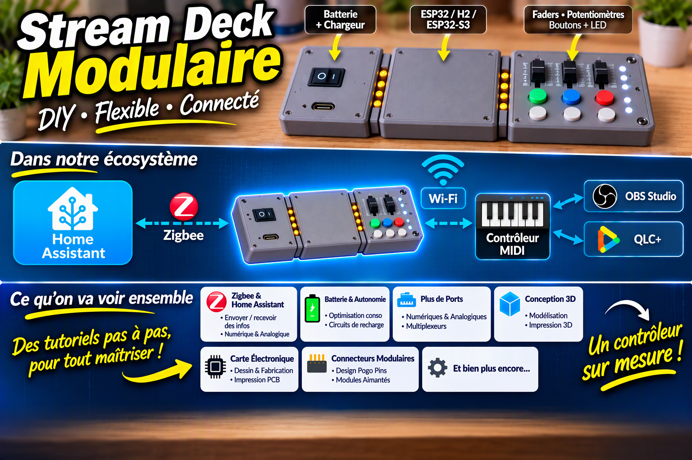

# Stream Deck modulaire DIY

> Un contrôleur personnalisable, évolutif et connecté, entièrement conçu et fabriqué en DIY avec des modules interchangeables, des boîtiers imprimés en 3D et une intégration à Home Assistant et au contrôleur MIDI.

# 📺 Vidéo

Lien Youtube: [https://www.youtube.com/watch?v=xs7xvXofpzQ](https://www.youtube.com/watch?v=xs7xvXofpzQ)

# Résumé visuel

## 1. Présentation du projet

L'objectif est de concevoir un **Stream Deck modulaire DIY**, constitué de plusieurs modules indépendants que l'on peut assembler et combiner selon ses besoins.

Contrairement à un contrôleur classique, ce projet repose sur une architecture évolutive : chaque module possède une fonction spécifique et peut être remplacé ou complété.

Les modules seront assemblés grâce à des aimants et connectés électriquement à l'aide de contacts **Pogo Pin**.

Le contrôleur pourra notamment servir à :
- Piloter des actions dans Home Assistant.
- Récupérer des informations depuis Home Assistant.
- Communiquer avec un contrôleur MIDI en Wifi.
- Piloter OBS Studio et QLC+ via le contrôleur MIDI.
- Ajouter de nouvelles commandes selon les besoins.

L'ensemble sera fabriqué avec des composants accessibles, des circuits électroniques personnalisés et des boîtiers imprimés en 3D.

## 2. Les trois modules principaux

### Module 1 : Batterie et chargeur

Ce premier module sera dédié à l'alimentation du contrôleur.

Il intégrera :
- Une batterie rechargeable.
- Un circuit de recharge.
- Les protections électriques nécessaires.
- Un connecteur USB-C.
- Un interrupteur marche/arrêt.

Le boîtier sera imprimé en 3D.

L'objectif est de conserver un design minimaliste, sans écran ni affichage : uniquement le port USB-C et l'interrupteur.

Les tutoriels permettront d'étudier les différents types de batteries, les circuits de recharge et les solutions permettant d'optimiser l'autonomie.

### Module 2 : Cœur électronique

Ce module accueillera le microcontrôleur et assurera la communication avec les autres équipements.

Deux architectures sont envisagées :

**ESP32-H2 : communication Zigbee**
- Communication avec Home Assistant.
- Échanges d'informations dans les deux sens.
- Faible consommation énergétique à étudier.
- Fonctionnement sur batterie.

**ESP32-S3 : communication Wi-Fi**
- Communication réseau.
- Possibilités d'évolution plus importantes.
- Intégration avec différents services et applications.

Le choix définitif dépendra des besoins du projet et des essais réalisés.

Le boîtier central sera également imprimé en 3D, avec un design sobre, sans boutons ni LED.

On pourra créer 2 modules interchangeables, un pour chaque architecture.

### Module 3 : Commandes

Ce module accueillera les différents éléments de contrôle.

Les composants envisagés sont :
- Faders / curseurs.
- Potentiomètres rotatifs.
- Boutons poussoirs classiques.
- LED indépendantes pour les retours d'état.

Les LED seront séparées physiquement des boutons et ne serviront qu'à afficher des informations ou des états.

L'intérêt de cette architecture est de pouvoir créer différentes versions du module selon les usages : davantage de boutons, plusieurs faders, des potentiomètres ou des combinaisons personnalisées.

## 3. Connexion entre les modules

L'un des éléments essentiels du projet est la modularité physique et électrique.

Les différents modules seront reliés grâce à deux systèmes complémentaires :

**Aimants**
- Faciliter l'assemblage.
- Assurer le positionnement des modules.
- Maintenir les modules entre eux.

**Connecteurs Pogo Pin**
- Assurer la connexion électrique.
- Transmettre l'alimentation.
- Transmettre les signaux nécessaires à la communication entre modules.

Les tutoriels aborderont notamment :
- Le choix des connecteurs.
- Le nombre de contacts nécessaires.
- La conception du brochage.
- Le positionnement des aimants.
- La conception mécanique des interfaces.
- La fiabilité des connexions après plusieurs assemblages.

## 4. Intégration dans l'écosystème

Le Stream Deck modulaire ne sera pas un appareil isolé. Il devra s'intégrer dans un environnement comprenant Home Assistant et plusieurs outils de production audiovisuelle.

### Home Assistant

Home Assistant permettra de récupérer des informations et de piloter différents équipements connectés.

Selon la version du contrôleur, la communication pourra être réalisée en Zigbee ou en Wi-Fi.

### Contrôleur MIDI

Le contrôleur MIDI constituera une autre partie de l'écosystème.

Il permettra notamment de piloter des logiciels compatibles MIDI comme OBS Studio et QLC+, et de faire le lien avec le Stream Deck modulaire.

### OBS Studio

OBS Studio permettra de déclencher différentes actions:
- Changement de scène.
- Activation ou désactivation de sources.
- Commandes d'enregistrement.
- Actions personnalisées.

### QLC+

QLC+ permettra de piloter les éclairages et les effets lumineux du studio.

L'objectif est de pouvoir utiliser les commandes physiques du Stream Deck pour déclencher des actions dans cet environnement.

### Architecture fonctionnelle envisagée

- Home Assistant communique avec le Stream Deck modulaire en Zigbee dans la variante ESP32-H2.
- Le Stream Deck modulaire communique avec le contrôleur MIDI en Wifi dans la variante ESP32-S3.
- Home Assistant pourra également communiquer avec le contrôleur MIDI en Wifi.
- Le contrôleur MIDI pilote OBS Studio et QLC+.

Les protocoles et les modalités précises des échanges seront définis pendant les phases de développement.

## 5. Programme des tutoriels

Le projet sera développé progressivement à travers plusieurs tutoriels.

### 5.1. Créer son propre appareil Zigbee

- Découvrir l'ESP32-H2.
- Créer un appareil Zigbee compatible avec Home Assistant.
- Déclarer les différentes fonctions.
- Envoyer des informations vers Home Assistant.
- Récupérer des informations depuis Home Assistant.

### 5.2. Communication numérique

- Lire un bouton poussoir.
- Envoyer un état numérique à Home Assistant.
- Recevoir une commande depuis Home Assistant.
- Gérer les entrées et sorties numériques.

### 5.3. Communication analogique

- Lire un potentiomètre.
- Lire un fader.
- Transmettre une valeur analogique à Home Assistant.
- Gérer la résolution et la calibration des mesures.

### 5.4. Batteries et autonomie

- Découvrir les différents types de batteries.
- Choisir une batterie adaptée.
- Comprendre les circuits de recharge.
- Ajouter les protections nécessaires.
- Réguler la tension.
- Mesurer la consommation.
- Optimiser le fonctionnement pour maximiser l'autonomie.

### 5.5. Augmenter le nombre de ports d'un ESP32

- Comprendre les limites des GPIO.
- Utiliser des multiplexeurs.
- Ajouter des entrées analogiques.
- Ajouter des entrées numériques.
- Ajouter des sorties numériques.
- Optimiser le câblage.

### 5.6. Conception et impression 3D

- Modéliser les différents boîtiers.
- Concevoir les assemblages.
- Intégrer les boutons et potentiomètres.
- Prévoir les logements des connecteurs.
- Imprimer les pièces en PLA.
- Ajuster les tolérances.

### 5.7. Connecteurs modulaires

- Étudier les différents types de Pogo Pin.
- Concevoir les interfaces de connexion.
- Positionner les aimants.
- Définir le brochage.
- Tester la fiabilité des connexions.

### 5.8. Concevoir et fabriquer sa propre carte électronique

- Dessiner le schéma électronique.
- Choisir les composants.
- Concevoir le PCB.
- Préparer les fichiers de fabrication.
- Faire fabriquer et assembler sa carte.
- Tester le circuit.

### 5.9. Programmation et firmware

- Organiser le programme.
- Gérer les différentes commandes.
- Associer les boutons à des actions.
- Gérer les valeurs des potentiomètres et faders.
- Gérer les LED de signalisation.
- Configurer les différents modules.

### 5.10. Tests et validation

- Tester chaque module indépendamment.
- Vérifier les communications.
- Mesurer l'autonomie.
- Tester les connexions magnétiques.
- Vérifier la fiabilité de l'ensemble.
- Intégrer le contrôleur dans l'écosystème Home Assistant et MIDI.

## 6. Philosophie du projet

Ce projet repose sur plusieurs principes :

- **DIY :** concevoir et fabriquer soi-même les différents éléments.
- **Modularité :** pouvoir assembler et remplacer les modules.
- **Évolutivité :** ajouter facilement de nouvelles fonctionnalités.
- **Accessibilité :** privilégier des composants abordables et disponibles.
- **Réparabilité :** pouvoir remplacer les éléments indépendamment.
- **Partage :** documenter les différentes étapes pour permettre à chacun de reproduire le projet.

## 7. Objectif final

L'objectif est de créer un **Stream Deck entièrement personnalisable**, capable de s'adapter aux besoins de chacun.

Un contrôleur qui pourra aussi bien piloter Home Assistant que des logiciels de production audiovisuelle, tout en restant évolutif grâce à ses modules interchangeables.

Et surtout, construire ce projet ensemble, étape par étape, en découvrant les différentes technologies nécessaires à sa réalisation.

**Un contrôleur sur mesure, fabriqué soi-même, évolutif et personnalisable !**